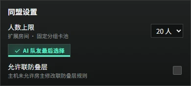
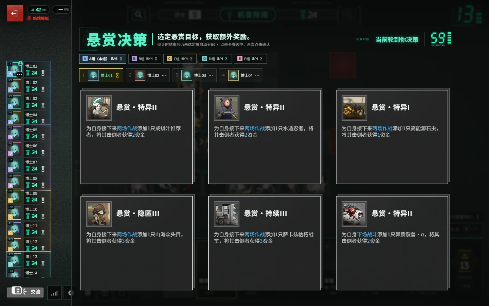
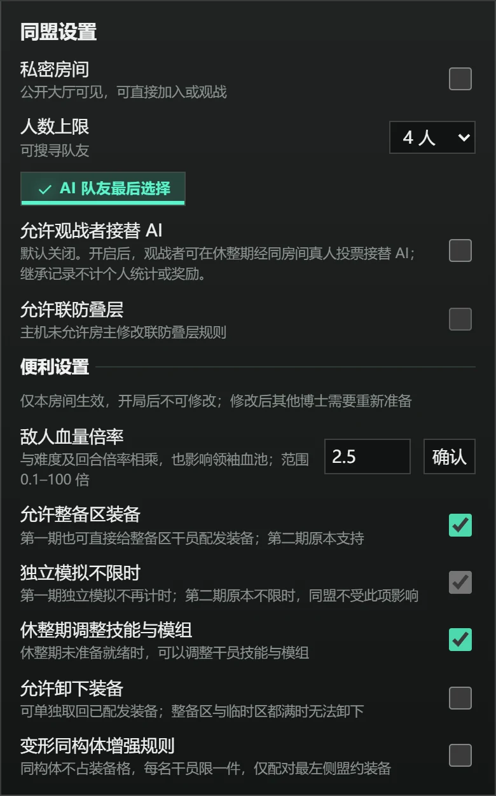
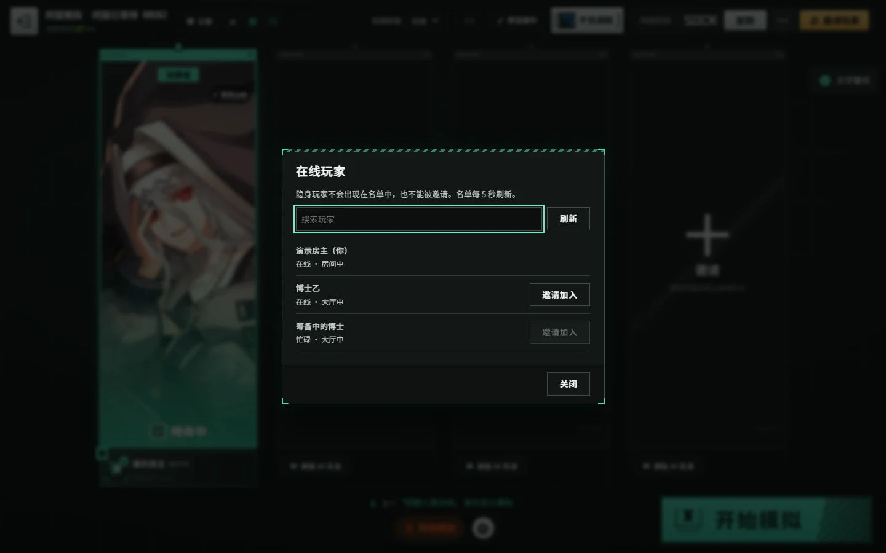
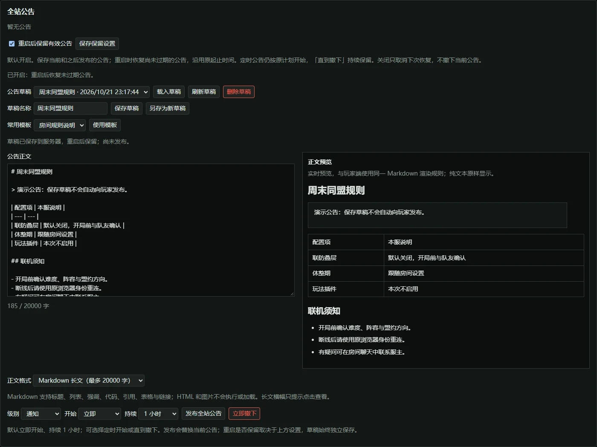
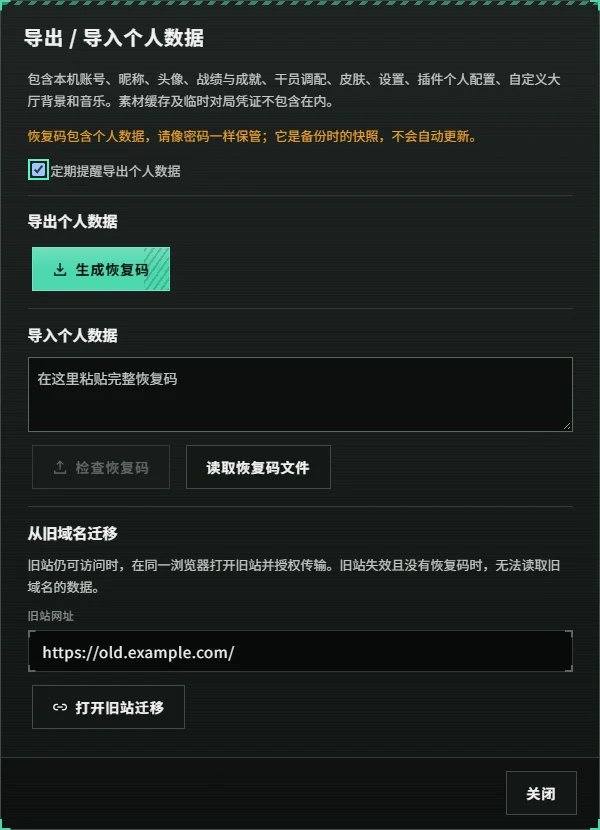
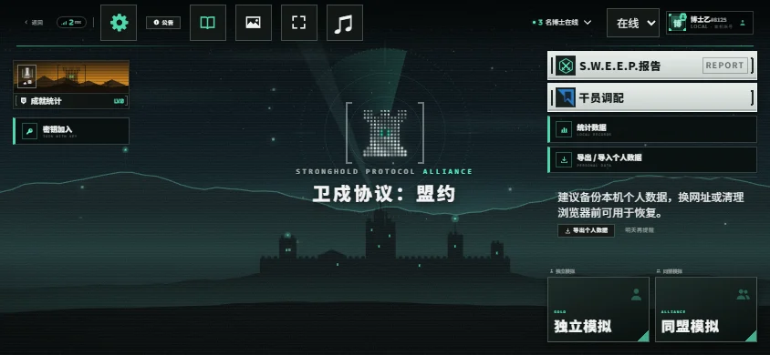
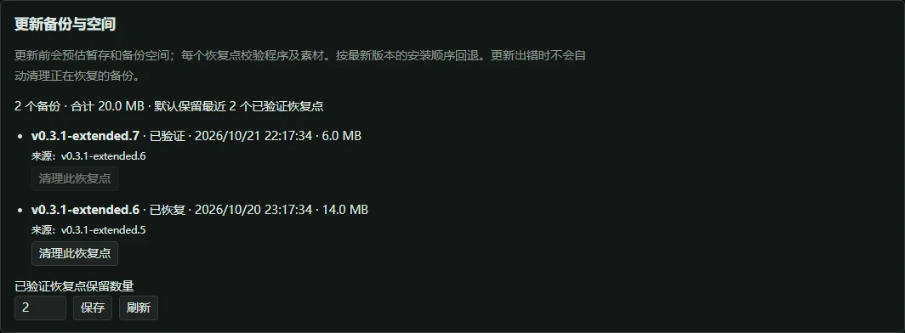

# 卫戍协议：盟约 · Stronghold Protocol: Alliance


在浏览器里招募干员、布置阵容，与朋友合作迎敌。本库是《明日方舟》「卫戍协议：盟约」的非商业同人扩展分支，支持独立模拟与默认 **1–4 人同盟模拟**，当前源码可选最多二十人，空位可由 AI 队友补齐。

在上游玩法和确定性战斗模拟的基础上，本分支重点完善**多人扩容、找人组队、主机管理、局内交流、统计回放、个人数据迁移和自行开服**，并保留联动干员、可选皮肤及社区 UI 适配。

A non-commercial fan remake of the Arknights mode *Stronghold Protocol: Alliance*, with online invitations, host tools, round statistics, replays, personal-data backups and optional cosmetics.

[下载正式版](https://github.com/zhewang448/Stronghold-Protocol/releases/latest) · [开始运行](#开始运行) · [本库特色](#本库特色) · [和朋友一起玩](#和朋友一起玩) · [更新记录](docs/LOCAL-CHANGELOG.md) · [反馈问题](https://github.com/zhewang448/Stronghold-Protocol/issues)

> 当前版本为 **`v0.3.3-extended.6`**，基于上游 0.3.3。修复领袖回合标点、控制台刷新中断操作及同名干员统计合并；保留房间敌人血量倍率、同盟大厅、四版本和主机工具。详情见[扩展更新记录](docs/LOCAL-CHANGELOG.md)。
>
> 非官方、非商业同人项目，与《明日方舟》官方无隶属或授权关系。游戏素材与数据的权利归原权利人；代码、素材及截图的许可边界见 [NOTICE.md](NOTICE.md)。

## 启动器有新版本：1.2.0

1.1.0及更早版本请先从本次 Release 下载 StrongholdProtocolLauncher-v1.2.0-win-x64.zip，关闭旧启动器，解压替换 EXE 后重新打开。关闭窗口不会停止后台游戏服务。此后可使用启动器顶部「启动器更新」独立更新，不需要与游戏实例放在同一目录。控制台同步更新需要先升级游戏更新器；实例外 EXE 需新版运行后登记位置。详见 [启动器说明](launcher/README.md)。

如果本项目帮到了你，欢迎点一下仓库右上角的 Star ⭐，也欢迎反馈问题，帮助这个非商业同人项目继续改进。

## 仓库索引

感谢原项目及社区作者的开源贡献。本库采用或参考的实现与对应作者列在下表，具体提交、许可证及署名见 [NOTICE.md](NOTICE.md)。

| 仓库 | 定位、采用内容与致谢 |
| --- | --- |
| [本库 · Stronghold-Protocol](https://github.com/zhewang448/Stronghold-Protocol) | 主机管理与联机体验扩展；本 README、整合包与问题反馈对应此仓库 |
| [原项目 · sganggs/Stronghold-Protocol](https://github.com/sganggs/Stronghold-Protocol) | 本库的玩法、确定性模拟、官方数据适配与插件体系基础；感谢 **sganggs 及上游贡献者**的原始实现与持续维护 |
| [多人扩容方案 · LongQianChen/Stronghold-Protocol](https://github.com/LongQianChen/Stronghold-Protocol/tree/feat/IncreasePlayerCapacity) | 本库采用解除四人限制、固定分组卡池与并行轮选的核心方案，感谢 **LongQianChen** 的多人扩容实现 |
| [多人扩容 0.3.1 适配 · SiderLock/Stronghold-Protocol](https://github.com/SiderLock/Stronghold-Protocol) | 本库迁移采用其 0.3.1 适配，感谢 **SiderLock** 的整合工作；具体提交及本库兼容调整见 [扩展联机说明](docs/EXPANDED-COOP.md#来源) |
| [原始社区 UI · isomerpoi/Stronghold-Protocol](https://github.com/isomerpoi/Stronghold-Protocol) | 本库大厅、同盟等待室、物资调配、对局 HUD 与结算界面的原始社区实现来源；感谢 **isomerpoi（雨千代chiyo）** 的界面设计与实现 |
| [UI 后续适配参考 · xinhai-ai/Stronghold-Protocol](https://github.com/xinhai-ai/Stronghold-Protocol) | 本库交流布局、快捷键、资源展示、公告 Markdown 和手机界面的后续适配参考；感谢 **xinhai-ai 及参考站贡献者**的公开实现，移植范围见 [源码对照文档](docs/REFERENCE-UI-REVIEW.md) |
| [参考站前端归档 · stronghold-ui-site-archive（私有）](https://github.com/zhewang448/stronghold-ui-site-archive) | 保存参考站公开前端快照、来源和哈希，供后续跟进 UI 变化；需仓库访问权限，更新方法见 [源码对照文档](docs/REFERENCE-UI-REVIEW.md#后续跟进与私有归档) |
| [Stronghold-Protocol-Forge-Mods](https://github.com/XiaMo233M/Stronghold-Protocol-Forge-Mods) | Forge 工坊包与成品索引；配套下方 Forge 宿主使用 |
| [Stronghold-Protocol-Forge](https://github.com/XiaMo233M/Stronghold-Protocol-Forge) | Forge-Mods 对应的游戏宿主与 MOD API |
| [RyantArgnisan/Stronghold-Protocol](https://github.com/RyantArgnisan/Stronghold-Protocol) | 本库房间文字聊天的参考与改编来源，感谢 **RyantArgnisan** 的开源聊天实现；具体提交见 [NOTICE.md](NOTICE.md) |
| [Stronghold-Protocol-Lele-Mods](https://github.com/llleeeqi/Stronghold-Protocol-Lele-Mods) | Lele 系列插件，需要其配套宿主适配 |

不同分支的插件格式和宿主 API 并不通用。**Forge-Mods 与 Lele 插件尚未验证可直接用于本库**；更多来源、安装前核对项和兼容边界见[社区插件索引](docs/COMMUNITY-PLUGINS.md)。本库设置页提供本机插件工作台入口。

本版已整合上游 **v0.3.3**，包含 Forge 导入与工作台扩展、测试房间、联防及干员规则修复，详见 [更新记录](docs/LOCAL-CHANGELOG.md)。

## 本库特色

| 方向 | 本分支提供的体验 |
| --- | --- |
| [多人扩容](#多人扩容与分组联机) | 解除四人房间限制，默认四人、可选最多二十人；固定分组卡池、策略与机变并行轮选，多轮联防及分组统计 |
| [同盟与房间设置](#同盟与房间设置) | 等待室设置人数、私密房间、AI 和便利规则；支持自定义敌人血量倍率 |
| [找人组队](#在线玩家状态与房间邀请) | 本服在线名单、姓名搜索与状态展示；在线 / 暂离 / 忙碌 / 隐身；等待室直接邀请，确认后加入 |
| [主机控制台](#主机控制台) | 房间和玩家管理、阵容与数值编辑、干员道具发放、实时查看与代操作、回档、敌人日程及监控墙 |
| [公告与交流](#公告聊天与战场标点) | 公告草稿、四类模板、Markdown 预览与跨重启保留；房间聊天、主机消息、屏蔽词和可拖动战场标点 |
| [复盘与记录](#局内统计对局记录与回放) | 全员每回合曲线与干员伤害排行、本机战绩、主机跨局汇总、最近 50 局回放 |
| [数据迁移](#个人数据备份与域名迁移) | 恢复码与文件导入 / 导出，覆盖本机配置、战绩、调配、皮肤、背景和音乐；旧域名授权传输 |
| [干员与外观](#联动干员皮肤与组队海报) | 7 名联动自选干员、224 套可选皮肤、可搜索的组队海报、随机外观与素材预加载 |
| [手机与个性化](#手机适配与个性化) | 手机横屏 HUD、可拖动聊天与标点、小屏统计和触控适配；自定义背景、音乐、界面设置及 FPS 显示 |
| [素材与加载](#素材与加载管理) | 统一入口与唯一下载按钮；按浏览器能力预载或兼容下载，本地素材与缓存 ZIP 导入 / 导出 |
| [插件与测试工具](#插件与测试工具) | 沿用上游插件工作台与 Forge 导入；本库控制台提供开发者模式、6 个模拟工具和 30 个场景入口 |
| [开服与维护](#开服更新与恢复) | 一键开服、公网隧道、重启恢复、签名增量更新与完整包回退；提供启动保护、更新验证和备份管理 |

上述功能包含本库新增、上游整合及社区界面适配，并非全部从零原创；来源与兼容边界见[仓库索引](#仓库索引)和[版权说明](NOTICE.md)。插件工作台、Forge 导入及确定性战斗模拟等继承自上游，使用方法见[插件指南](docs/PLUGIN-GUIDE.md)。

## 开始运行

Windows 服主从同版本 Release 下载 StrongholdProtocolLauncher-v1.2.0-win-x64.zip，解压后双击 StrongholdProtocolLauncher.exe。可新建空目录自动安装完整游戏包和便携 Node.js，也可导入已有根目录；EXE 可放在实例目录外。启动器支持多实例、监听端口＋索引发现、回收站删除和安全控制，不提供文件搜索。

**关闭启动器窗口后服务继续运行；停服请点击「停止服务器」。** 公网隧道另需 cloudflared。使用与构建见 [启动器说明](launcher/README.md)，原脚本继续可用。

需要 **Node.js 22 或 24** 和支持 WebGL 的现代浏览器；Windows、macOS、Linux 均可开服。手机建议横屏游玩，战斗在玩家浏览器中模拟，设备性能会影响流畅度。

### 下载整合包

从[本库 Releases](https://github.com/zhewang448/Stronghold-Protocol/releases)选择附件，解压到新目录：

| 附件 | 适合的情况 |
| --- | --- |
| `*-assets.zip` | 带游戏代码、运行依赖、11 个官方战场场景、官方 3D 棋盘、40 组召唤物模型、中文 / 日文语音等本地素材与 224 套可选皮肤，适合希望直接启动的玩家 |
| `*-lite.zip` | 带同版代码与运行依赖，首次启动时联网下载默认素材；官方战场场景、棋盘等本地素材和可选皮肤需另行导入 / 安装 |
| `*-update.zip` | 发布时若提供，为控制台升级使用的增量附件；不能当作新安装包，版本不适配时改用完整包 |
| `SHA256SUMS.txt` | 用于核对安装包的 SHA-256 校验值 |
| `SHA256SUMS.txt.sig` | 维护者对校验值的 Ed25519 签名，控制台更新据此确认安装包来自本库；更早的版本没有此附件 |

- **Windows**：随包有同版 `StrongholdProtocolLauncher.exe` 时可双击使用；否则双击 `scripts/start-windows.bat`。
- **macOS / Linux**：在解压后的项目目录运行 `bash scripts/start.sh`。

脚本会检查环境与素材、启动服务器并打开浏览器。默认游戏地址为 `http://localhost:3000`，控制台地址见启动日志的 `Console:` 行。

### 升级

从旧版首次升级到本版时，先停止服务器，解压新包到新目录，再把旧目录 `logs/` 中需要的记录和设置迁移过去。之后可在控制台更新；手动安装时有活动对局仍需确认结束。恢复文件绑定版本及规则指纹，升级后不保证可恢复，建议打完再升级。从 0.2.6 升级到 0.3.0 时需要补齐新增官方特效、语音与海报素材；完整包已包含，轻量包 / 源码安装后重新运行 `npm run setup`。详见[部署说明](docs/DEPLOY.md#本库拓展版控制台下载并安装)。

### 从源码运行

```powershell
git clone https://github.com/zhewang448/Stronghold-Protocol.git
cd Stronghold-Protocol
npm install
npm run setup
npm start
```

`setup` 准备数据和默认素材；下载中断后可重新运行续传。网络下载失败时可尝试：

```powershell
node tools/setup.mjs --asset-source=mirror
```

需要皮肤时另外安装，然后重启服务器并刷新游戏页面：

```powershell
node tools/install-skins.mjs --all
```

安装选项与失败重试见[皮肤说明](docs/SKINS.md)。启动有问题时运行 `npm run doctor`，检查 Node 版本、素材、端口与网络配置。

### 官方本地素材

表情和「玩法说明」的教程图随上面的素材一起从公开镜像下载。源码和轻量包的默认下载流程不含官方战场场景、3D 棋盘、召唤物模型等本地素材；缺少场景时 3D 棋盘回退为金属地块。可从**同一基础版本**的上游完整包复制 `public/assets/local/` 和 `data/local-assets.json`，或从本机游戏客户端提取，具体见[部署说明 §6](docs/DEPLOY.md#6-本地客户端素材可选)。

## 和朋友一起玩

1. 主机启动服务器，将启动日志里的**局域网游戏地址**发给朋友；同一网络的玩家在浏览器里打开它。
2. 选择「同盟模拟」并创建同盟，分享 4 位密钥或邀请链接；也可从等待室直接邀请本服在线玩家，对方确认后加入。
3. 等待朋友加入，或加入 AI 队友填补空位，再开始对局。

不在同一局域网时，Windows 可用本库开服脚本生成临时公网地址。先安装 Node.js 与 cloudflared，并完成游戏环境准备：

```powershell
winget install Cloudflare.cloudflared
.\scripts\start-tunnel.bat
```

当前源码的启动器共用环境准备，复用经身份核验的本机服务，未知端口占用者会保留并提示换端口；受启动器管理的服务器重启时保留隧道进程。整机或隧道进程重新启动仍可能更换临时网址，换网址前请先[导出个人数据](#个人数据备份与域名迁移)。按 `Ctrl+C` 停止本窗口创建的进程；附加到已有服务时只关闭本窗口的隧道。这些启动改进自 `v0.3.1-extended.7` 提供，旧包以随包脚本说明为准。可用 `--port 3001` 改游戏端口，或用 `--no-tunnel` 只开局域网。后台常驻与脚本参数见[开服脚本说明](scripts/README.md)，虚拟局域网、端口转发等其他方式见[部署说明](docs/DEPLOY.md)。

自建反向代理需要转发 WebSocket `/ws`，并在域名根路径运行单个常驻 Node.js 实例。玩家资料保存在本机浏览器，不是线上账号登录系统；知道游戏地址的人即可进入。主机控制台留在开服电脑本机使用。

刷新或断线后，同盟模拟可在 **10 分钟**内重连，独立模拟可在 **24 小时**内恢复原座位，前提是服务器和该对局仍在运行。默认每次休整期保存本机恢复文件；同版本重启后恢复进行中的对局，回到最近休整期开始，保留当时机变，作战中重启需重打本回合。玩家仍用原浏览器身份重连。等待室与聊天不恢复；关闭恢复或版本指纹不符时不能自动续局；玩法插件局暂不支持跨服务重启恢复。

## 本库特色详解

### 命名调配预设

干员调配页可将当前方案命名保存，并通过顶栏选择器切换，最多保留20个预设。支持重命名、另存为和删除；
手动修改不会自动覆盖预设，切换前可选择保存修改、直接切换或取消。宽屏入口在顶栏，小屏独立成行。
预设跨玩法版本共用，默认保存技能、模组、潜能、练度和皮肤，可选随机皮肤策略、锁定名单及指定版本的自选编队。
空编队会明确标注；应用只替换勾选部分，未勾选内容保持不变，自选编队仍受局外限制。
预设仅保存在当前浏览器与站点，可随个人数据恢复码备份和迁移；不包含干员持有、棋盘站位或局内装备。
保存时可选择全部已保存配置，或勾选玩法版本后仅保存这些版本的全部／独有可调配干员。独有指其他三个版本均没有；
名单在保存时固定，应用只覆盖名单内干员，名单外配置保留。自选专用干员可用全部配置保存，自选编队版本仍单独选择。
同样的版本全部／独有分类也可在调配筛选、导出及导入中使用。筛选只作用于当前页面；导入会预览格式、来源范围和可选字段，
可继续缩小范围并取消不想导入的内容。带范围保护的本库文件使用v3，旧页面会拒绝；上游兼容v2继续保留原格式，不支持范围。

以下截图来自本机测试实例或维护者提供的实际界面；自动拍摄使用演示数据，不含私人聊天或管理凭据。手机截图为横屏浏览器视口，部分图片裁剪了无关区域。多人扩容截图对应 `v0.3.1-extended.8`，其余截图展示此前已有功能；具体拍摄来源见 [截图说明](docs/img/features/README.md)。

### 多人扩容与分组联机

**解除原有四人联机上限，当前最多二十人。** 创建同盟后，房主可在等待室底部齿轮的「同盟设置 → 人数上限」中选择 **4 / 8 / 10 / 16 / 20 人**，默认仍为四人；开局后人数上限固定，空位可添加 AI 队友。



开局实际参战人数决定分组，包含 AI、不含空位和观战者。六人起使用固定卡池分组；二十人分成 **A–E 五组，每组四人**。各组干员与装备库存独立，策略和机变按组并行、组内依次选择，每组机变各有六个选项。退出或淘汰后不会重新分组。



联防每场仍最多两名助手，可按固定组数继续后续轮次，最多五轮；首领战仍按两人分场，不扩大棋盘。局内和结算统计支持本组 / 全部玩家筛选，二十席使用固定玩家色；主机监控墙按每页四席切换。

这一社区扩展沿用上表两个来源仓库的方案，并适配本库的回档、重启恢复、统计与完整漏怪结算。具体规则、普通四人兼容范围和验证记录见 [扩展联机说明](docs/EXPANDED-COOP.md)。

### 同盟与房间设置

在等待室点击底部齿轮打开「同盟设置」。房主可在开局前设置私密房间、同盟人数上限、AI 队友最后选择，以及在主机允许时设置观战者接替 AI 或联防叠层；独立模拟中不适用的同盟选项不会生效。



「便利设置」包括允许整备区装备、第一期独立模拟不限时、休整期调整技能与模组、卸下装备和变形同构体增强规则。新房间默认开启前三项、关闭后两项；插件声明的相应规则优先。设置仅影响当前房间，开局后不可更改；修改便利设置后其他真人玩家需要重新准备。

房间还可自定义敌人血量倍率，范围 **0.1–100 倍**、默认 **1 倍**。普通敌人的血量在原有难度及回合倍率基础上再乘此值，领袖共享血池也乘此值。例如原倍率为 1.728、房间设为 2 倍时，普通敌人的最终倍率为 3.456。非 1 倍房间不参与公开匹配；玩家本机对局记录标记为非官方，默认不计入统计总览和成就统计。修改倍率同样会使其他真人玩家重新准备。控制台跨局汇总默认只包含规则已确认的本项目默认对局，可切换到自定义、未知或全部记录；旧记录缺少规则信息时标为未知。回放页面仍不单独显示房间倍率。

同盟房主还可开启默认关闭的「独立卡池」：每名玩家和 AI 分别持有完整的同盟干员与装备库存，互不占用；自选编队仍使用个人库存。策略和机变轮选及联防分组保持原规则，已显示的卡仍遵循原有超额购买规则。此选项为非官方玩法，房间不参加公开匹配，对局默认不计入本机官方统计与成就；改变设置后其他真人玩家须重新准备。

### 在线玩家、状态与房间邀请

点击大厅右上角「名博士在线」查看**当前服务器**的可见在线玩家，可搜索姓名并查看大厅、房间或对局状态。你可以选择在线、暂离、忙碌或隐身，选择在当前浏览器记忆；隐身玩家不进入在线名单及可见人数，也不能发送或接收邀请。

建房后从等待室「邀请玩家」选择本服空闲玩家，对方主动确认后才加入。邀请不会绕过房间容量、阶段或隐私检查，60 秒后失效；也可继续分享 **4 位字母 / 数字同盟密钥**或房间链接，无需注册线上账号。



服主可分别控制在线名单、邀请、状态选择、隐身选择、可见人数和「仅房主邀请」。隐身影响发现与邀请，共同房间中的实际席位仍然可见。

等待室还可预选八个核心盟约之一，让队友提前了解组队方向；该选择只用于沟通，不修改卡池、盟约层数或战斗数值。本服在线邀请不等于跨服务器好友系统，未接入的联邦匹配、好友及云端账号入口不会冒充可用功能。

### 主机控制台


控制台只在开服电脑本机开放，默认地址为 `http://127.0.0.1:3100`，以启动日志的 `Console:` 行为准。顶部显示在线人数、房间、对局、CPU 与内存；房间分为「操作 / 数据」，玩家调整收进展开区，对局记录支持搜索与每页 20 条分页。


| 功能 | 说明 |
| --- | --- |
| 房间与玩家 | 结束休整期、暂停 / 继续独立模拟、结束对局、关闭房间；修改 LP、金币、商店等级、免费刷新和托管状态 |
| 阵容与发放 | 发放干员、道具、自选技能和模组，编辑棋盘、精锐与装备，管理效果、悬赏和机变卡；不可叠层盟约省略层数编辑 |
| 实时查看与代操作 | 复用游戏界面，约每 500 ms 同步；默认只读，主动开启代操作后按普通规则购买、布阵、装备和准备 |
| 回档与敌人日程 | 回到任一回合休整期开始，恢复随机数、统计与首领搭档；可展开查看和指定敌人组合 |
| 监控与服务 | 四席只读监控墙、资源与 RTT 面板、战场执行和接管状态；房间规则、等待室阻塞原因及按组库存；全站公告、重启与关闭服务集中到「服务器」 |
| 事件记录 | 按房间查看连接、异常、接管及主机操作，关键数值显示修改前后；本机保留最近 2000 条，可在「数据清理」中删除 |

除代操作外，主机修改直接生效、不扣金币，使用前请与同局玩家约定。共享库存超额发放需要确认，手牌和整备区容量仍受限制。代操作不接管玩家身份或结算；AI、已退出或淘汰玩家只可查看。控制台监听 `127.0.0.1` 并校验 token，不随游戏地址或隧道公开。接口与限制见[扩展开发笔记](docs/LOCAL-DEV.md)。

### 公告、聊天与战场标点

全站公告支持**最多 30 份草稿**，可保存、载入、另存、覆盖和删除；提供维护、更新、房间规则和临时故障四种模板，以及安全的 Markdown 实时预览。保存草稿或使用模板不会向玩家发布，仍需主动点击发布。已发布公告默认在重启后保留，沿用原定时与截止时间，过期或已撤下内容不恢复；服主可关闭保留。



房间文字聊天贯穿等待室与对局，保留最近 50 条消息，支持重连历史、未读提醒和草稿；每条最多 200 字，观战席只读。拖动聊天按钮或标题可调整位置，按浏览器、站点与玩家名保存。

控制台「聊天管理」可**向当前房间发送主机消息**，并清空聊天、禁言 / 解禁、踢出玩家或观战者；全站公告在「服务器」中单独管理。设置中的屏蔽词按普通文本、忽略大小写匹配，命中部分替换成 `***`，作用于之后发送的玩家和主机消息，保存后立即生效并跨重启保留。


主机设置依次为 **对局设置 → 交流管理 → 记录与恢复 → 维护与扩展 → 数据清理**，每项独立保存，清理操作放在底部。可配置休整期时长、可选联防叠层、局内每回合统计、屏蔽词、回放录制、重启恢复和空闲自动更新，也可进入插件工作台。联防叠层默认关闭，开启后援助干员在联防中重新获得叠层额度。

每个房间可独立选择联防叠层；服主需先开启「允许房主自行设置联防叠层」，默认关闭该权限。最终攻势与隐秘核心不因此获得叠层。


战场标点有注意、进攻、危险、撤退、问号和爱心等类型，带发送者名字、落点动画与分类音效，2.5 秒后消失。选类型后点棋盘格，或**右键棋盘空地 / 干员**发送；观察同一战场的玩家与观战者都能看见。聊天和标点不进入战斗模拟、回档或回放。

### 局内统计、对局记录与回放

局内「交流」图标后增加 **「每回合统计」**，玩家和观战者均可打开，在同一面板切换**回合曲线**与**每回合干员伤害排行**，复用控制台图表。曲线支持指标切换与数值表格，排行支持回合、玩家和前十 / 全部筛选。盟约曲线只列可叠层盟约。主机设置默认开启，可统一控制所有房间是否显示。


原来的 **DPS / HPS「作战统计」默认开启**，可在玩家设置中单独关闭；已经保存的关闭偏好会保留。它与按已结算回合汇总的面板各自独立。

控制台另提供 LP / 金币曲线、漏怪明细、收入 / 支出来源与次数、累计伤害排行，以及跨局胜率、干员和盟约使用汇总。汇总支持时间、模式、版本、难度与规则筛选；默认不混入自定义、主机干预或规则未知的对局，旧记录缺失字段不推算。结束后的对局和事件记录保存在 `logs/results/`；玩家浏览器里的「统计（本机）」独立保存，可导入 / 导出。

整局回放默认保留最近 **50 局**，从「对局记录 → 回放」进入。可按回合查看阵容、敌人和结果，播放普通战斗与联防，支持暂停、重播和 1 / 2 / 4 / 8 倍速。第 14、15 回合可确认后尝试播放，但录制不含实时共享血池与全队生命同步，结果可能不同。玩法插件局暂不支持跨服务重启恢复；需要额外脚本授权的回放会明确拒绝启动。详见[实现与兼容边界](docs/LOCAL-DEV.md)。

### 个人数据备份与域名迁移

在**标题页或大厅 → 导出 / 导入个人数据**生成恢复码，支持复制及保存为 `.spdata` 文件。备份包含本机账号资料、昵称头像、战绩成就、干员调配 / 持有 / 自选编队、皮肤与界面偏好、插件个人配置，以及自定义背景和音乐；不携带重连令牌、主机管理权限或缓存。

导入时先校验恢复码并展示摘要，确认后才恢复：战绩按记录去重合并，同名配置按备份恢复，失败时回滚。旧域名仍可访问且支持迁移时，也可打开旧站窗口，由你确认目标并授权传输。



**换域名不会自动带走浏览器数据。** 临时公网地址失效、浏览器数据被清理且没有事先备份时，无法从旧域名找回；恢复码包含个人数据，请妥善保管。本版增加临时域名与长期未导出的提醒，可延后或关闭，提醒记录不进入迁移包。

### 联动干员、皮肤与组队海报

自选池共 **79 名**干员，比上游增加灰烬、艾拉、麒麟R夜刀、玛露西尔、丰川祥子、结城理、焰狐龙梓兰这 **7 名联动干员**。可在「干员调配 → 自选编队」配置，或由控制台发放；部分专属视觉效果和外语文本尚未完成，见[联动实现说明](docs/LOCAL-DEV.md#8-联动干员进自选池)。

可选皮肤覆盖 **115 名干员、224 套皮肤**，支持手选、随机装备、随调配文件导入 / 导出，以及联机、重连与观战同步。只改变外观，不改变战斗数值。设置里可预加载画面或全部素材，查看进度并取消，详见[皮肤说明](docs/SKINS.md)。


组队海报有常显的更换按钮，可搜索当前目录中的 **432 名干员、1,356 张立绘**，选择记在本机并同步给队友。海报独立于战斗皮肤，清空选择恢复自动分配。


另外支持自定义 **4 位字母 / 数字同盟密钥**，留空自动生成；禁用干员在开局简报、策略选择和局内信息中按盟约分组，包含图标、人数与头像，多盟约归属分别展示、总数去重。

### 手机适配与个性化

手机以**横屏**使用，等待室、顶部 HUD、统计面板和底部工具按小屏空间适配。聊天和战场标点可拖动并记住位置，触控操作兼容点按、长按和滑动；空间不足时工具区横向滚动，打开详情等面板时标点临时让位。



大厅可选择或上传背景、导入本地音乐，并设置画质、字号、帧率上限和实际 FPS 显示。调配、皮肤、背景与音乐等个人选择保存在当前浏览器，可通过个人数据备份迁移。小屏适配不修改战斗坐标或游戏规则，移动端性能仍取决于设备；不承诺所有实体设备或 Safari 均已验证。

### 素材与加载管理

设置和资源入口可按**必需画面、可选音频与语音语言**预载，支持暂停 / 继续、失败重试、清理缓存及资源 ZIP 导入 / 导出。清单以当前服务器实际安装的素材为准，未安装的皮肤或本地素材不会凭空出现在列表中。

HTTPS / localhost 使用浏览器资源缓存，普通局域网 HTTP 保留预热能力；清理只影响本功能自己的缓存，不会顺带清除个人配置与战绩。资源缓存不等于游戏可以完全离线运行，代码、API 和 WebSocket 不由该缓存接管。说明与限制见[素材文档](https://github.com/zhewang448/Stronghold-Protocol/blob/main/docs/ASSETS.md)。

### 插件与测试工具

沿用上游的**插件工作台、Forge 导入、图形化模板与试跑能力**，从主机设置进入，按本库插件格式与权限校验安装内容。社区分支的插件和宿主 API 并不通用，不能仅凭文件名就认定可直接运行；入门见[插件指南](docs/PLUGIN-GUIDE.md)，来源和配套宿主见[社区插件索引](docs/COMMUNITY-PLUGINS.md)。

本库控制台的**开发者模式**集中提供 6 个模拟工具与 30 个中文场景入口，新页面复用当前本机会话，无需手填游戏端口。测试房间需服主显式开启，默认关闭；这些工具用于本机调试与验证，不向普通玩家提供管理权限。实现和入口见[扩展开发笔记](docs/LOCAL-DEV.md#2026-10-18-控制台开发者模式)。

### 开服、更新与恢复

| 环节 | 现有能力与边界 |
| --- | --- |
| 一键开服 | Windows 普通入口与公网入口；游戏地址可分享，控制台仅在开服电脑本机访问，不能把控制台端口暴露到公网 |
| 对局重启恢复 | 原版局默认每个休整期保存快照；同版本与规则指纹一致时回到最近休整期开始，作战中重启需重打本回合 |
| 签名增量更新 | 控制台优先使用已签名增量包，不适配或验证失败时改用同版本完整素材包；回退旧版和修复素材始终使用完整包 |
| 空闲自动更新 | 需主动开启；等待活动对局结束，公告后再安装，新局会取消倒计时，不强制结束对局 |
| 启动保护 | 普通 / 公网启动共用准备流程，核验实例身份，不强杀未知进程；计划重启保留隧道，异常重试有上限 |
| 更新验证 | 检查下载、展开与备份空间；验证候选启动、前端资源及 WebSocket，再检查正式服务，复制完成不等于成功 |
| 备份管理 | 控制台显示备份大小与状态，默认保留最近 2 个已验证恢复点，可设 1–20；保护关键备份，提供校验后的离线恢复工具 |



对局恢复、程序更新备份与玩家个人数据备份是三种不同用途：**跨版本升级不保证续局，程序恢复点也不是整机或用户数据快照。** 只读更新验证失败可以恢复原程序；正式服务启动失败可能已写入运行期数据，因此会给出停服后的恢复说明。完整流程见[部署说明](docs/DEPLOY.md#本库拓展版控制台下载并安装)与[开服脚本](scripts/README.md)。

## 操作

休整期招募、配装与部署，作战期自动迎敌；漏怪时顶栏用红字 + 「−N」标记待扣的目标生命值，结算时才显示扣除后的数值。点击干员按地上的方格定位。

| 操作 | 方法 |
| --- | --- |
| 购买 / 升级 / 机变选卡 | 点一次选中，再点一次确认 |
| 部署 / 移动 | 将干员拖到棋盘格，方向轮盘选择朝向后松手 |
| 调整朝向 | 拖回干员自己的格子，重新选择方向 |
| 配装备 | 拖到干员所在格；每人 2 件，替换会销毁旧装备，已配发的装备锁定在干员身上 |
| 查看详情 | 左键棋盘干员；右键卡牌 / 整备区干员，或长按查看 |
| 常用快捷键 | `W` 悬停购买、`R` 刷新、`F` 冻结、`D` 升级、`Q` 撤退、`X` 出售、`Space` 准备就绪、`Esc` 取消 / 关闭；在设置中查看或修改 |
| 暂停（独立模拟） | 作战中点「暂停」或按 `Space`；同盟模拟的作战不能暂停 |
| 文字聊天 | 「文字聊天」展开；拖动按钮 / 标题可移动并记住位置；Enter 发送，Shift+Enter 换行，Esc 收起；观战席只读 |
| 战场标点 | 左下角选标记后点棋盘格；右键棋盘空地或干员发送当前类型，Esc 或再次点选取消 |
| 每回合统计 | 局内交流图标后的统计按钮，切换曲线 / 干员排行；主机默认开启 |
| 本机统计 | 从标题画面、大厅或等待室进入「统计」 |

详细规则、观战、快捷键与玩法说明见[玩法指南](docs/PLAYING.md)。界面支持简体中文、English、日本語、한국어、繁體中文；在标题画面或设置中切换。

## 配置与数据保存

| 环境变量 | 默认值 | 作用 |
| --- | --- | --- |
| `PORT` | `3000` | 游戏端口 |
| `HOST` | `::` | 游戏监听地址，支持 IPv4 / IPv6；仅本机使用可设为 `127.0.0.1` |
| `SP_ADMIN_PORT` | 游戏端口 + 100 | 本机控制台端口 |
| `SP_ADMIN` | `1` | 设为 `0` 关闭控制台（同时不保存对局记录和回放） |
| `SP_ASSET_INDEX` | 开启 | 素材地址带内容哈希并长期缓存；设为 `0` 关闭，哈希缓存保存在 `.cache/asset-hashes.json` |

例如在 PowerShell 中把游戏端口改为 `8080`：

```powershell
$env:PORT = '8080'
npm start
```

| 内容 | 保存位置 | 重启服务器后 |
| --- | --- | --- |
| 等待室、最近 50 条聊天、实时控制台操作日志 | 服务器内存 | 清空 |
| 进行中对局的休整期恢复快照（含重连身份） | `logs/recovery/` | 默认恢复；须同版本及规则指纹 |
| 恢复与空闲自动更新开关 | `logs/recovery-settings.json`、`logs/auto-update.json` | 保留 |
| 主机历史对局 | `logs/results/` | 保留 |
| 整局回放（最近 50 局） | `logs/replays/` | 保留 |
| 主机时长、联防叠层、每回合统计、社交策略、屏蔽词与回放录制设置 | `logs/admin-settings.json` | 保留 |
| 公告草稿与有效公告保留设置 / 正文 | `logs/announcement-drafts.json`、`logs/announcement-state.json` | 草稿保留；正文按原时限与开关恢复 |
| 更新备份、版本和保留策略 | `logs/update-backups/`、`logs/release-version.json`、`logs/update-backup-settings.json` | 保留；按安装顺序使用恢复点 |
| 玩家身份、调配、皮肤偏好、本机统计、背景和音乐 | 玩家浏览器本地存储 | 服务器重启通常不受影响；换浏览器、换域名或清理站点数据前应导出备份 |
| 下载的游戏与皮肤素材 | `public/assets/` 等本地资源目录 | 保留 |


数据位置与分享前的隐私检查见[本地数据说明](docs/PRIVACY.md)，更多部署选项见[部署说明](docs/DEPLOY.md)。

## 文档与开发

| 文档 | 内容 |
| --- | --- |
| [扩展更新记录](docs/LOCAL-CHANGELOG.md) | 本库扩展、版本与验证记录 |
| [CHANGELOG.md](CHANGELOG.md) | 上游基础版本更新记录 |
| [扩展开发笔记](docs/LOCAL-DEV.md) | 控制台、回档、回放、联动干员等实现细节 |
| [部署说明](docs/DEPLOY.md) | 开服、后台运行、跨网联机、更新与本地素材 |
| [社区插件索引](docs/COMMUNITY-PLUGINS.md) | 插件库、宿主关系与兼容边界 |
| [皮肤说明](docs/SKINS.md) | 安装、外观同步、随机装备与预加载 |
| [开服脚本](scripts/README.md) | Windows 隧道、停服与后台运行 |
| [架构](https://github.com/zhewang448/Stronghold-Protocol/blob/main/docs/ARCHITECTURE.md) / [设计](https://github.com/zhewang448/Stronghold-Protocol/blob/main/docs/DESIGN.md) | 代码入口、当前规则与接口约定（在线开发文档） |
| [贡献指南](https://github.com/zhewang448/Stronghold-Protocol/blob/main/CONTRIBUTING.md) / [助手指引](https://github.com/zhewang448/Stronghold-Protocol/blob/main/AGENTS.md) | 环境准备、改动与验证要求（在线开发文档） |

```powershell
npm test             # 单元与集成测试
npm run ci           # 测试、启动 smoke、lint、导入边界与类型检查
npm run golden       # 确定性战斗与整局黄金结果
```

先运行改动涉及的测试，再执行完整检查。真实浏览器测试需要系统 Chrome / Edge 和对应的环境开关，配置见[贡献指南](https://github.com/zhewang448/Stronghold-Protocol/blob/main/CONTRIBUTING.md)。生成数据通过 `npm run build-data` 更新，不手工编辑 `data/*.json`；不将下载或提取的游戏素材提交到仓库。

问题和功能建议请提交到[本库 Issues](https://github.com/zhewang448/Stronghold-Protocol/issues)，说明运行方式、扩展版本、复现步骤与相关日志。

## 来源与许可

本库在原项目基础上继续开发；原项目的介绍、版本记录及致谢见[原项目 README](https://github.com/sganggs/Stronghold-Protocol/blob/master/README.md)。文字聊天借鉴 RyantArgnisan/Stronghold-Protocol 的 GPL 实现，署名见 [NOTICE.md](NOTICE.md)；其他扩展的参考来源记录在相应开发文档中。

代码以 **GPL-3.0-or-later** 发布，见 [LICENSE](LICENSE)。游戏素材与数据不适用代码许可证；版权、Spine 组合分发附加许可和第三方组件说明见 [NOTICE.md](NOTICE.md) 与 [THIRD-PARTY-NOTICES.md](THIRD-PARTY-NOTICES.md)。本项目保持非商业使用，不接受广告、付费服务或其他变现功能。

## 四版本默认开放（本地扩展）

可从大厅选择第二期下半、第二期上半、第一期下半、第一期上半，默认选中第二期下半。已有同盟通过房主提案及真人一致投票切换。历史版保留规则推算提示，本地联动仅默认版提供；服主可用 `--versions act2autochess` 限制单版，或用 `--versions <id,id> --version-default <id>` 指定列表与默认项，详见 [部署配置](docs/DEPLOY.md#11-四版本开放与部署配置)。
