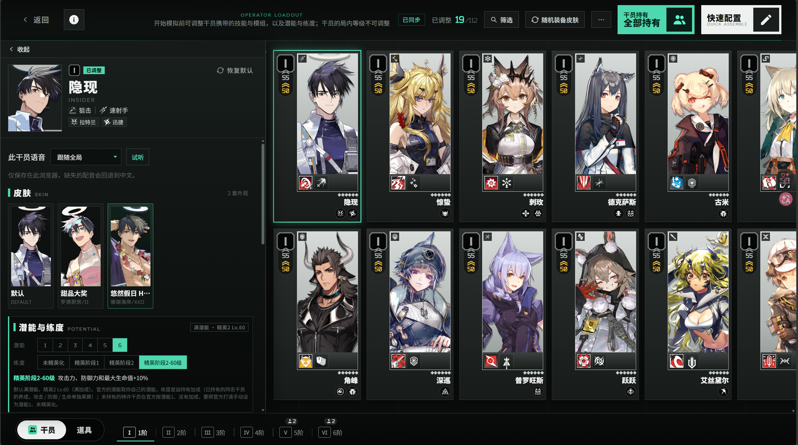
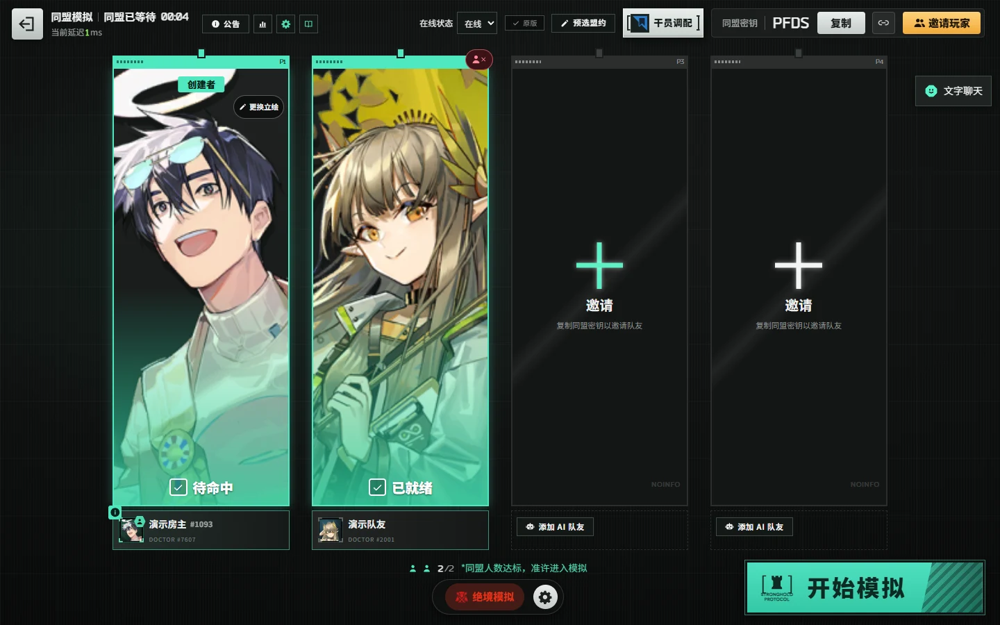

# 卫戍协议：盟约 · Stronghold Protocol: Alliance


在浏览器里招募干员、布置阵容，与朋友合作迎敌。本库是《明日方舟》「卫戍协议：盟约」的非商业同人扩展分支，提供独立模拟与 **1–4 人同盟模拟**，空位可由 AI 队友补齐；着重完善自行开服、主机管理、局内交流与统计、对局回放和外观选择。


A non-commercial fan remake of the Arknights mode *Stronghold Protocol: Alliance*, extended with host tools, shared round statistics, chat, replays and optional cosmetics.

[下载正式版](https://github.com/zhewang448/Stronghold-Protocol/releases/latest) · [开始运行](#开始运行) · [和朋友一起玩](#和朋友一起玩) · [更新记录](docs/LOCAL-CHANGELOG.md) · [玩法指南](docs/PLAYING.md) · [反馈问题](https://github.com/zhewang448/Stronghold-Protocol/issues)

> 当前版本为 **`v0.3.1-extended.6`**（基础版本 `0.3.1`）。新增在线玩家名单、状态与隐身、房间直接邀请及控制台管理；支持房间联防叠层权限和公告草稿、模板、Markdown 预览。提供签名完整素材包与轻量包。新版内容见[扩展更新记录](docs/LOCAL-CHANGELOG.md)，上游变化见 [CHANGELOG.md](CHANGELOG.md)。
>
> 非官方、非商业同人项目，与《明日方舟》官方无隶属或授权关系。游戏名称、美术、音频、文本与数据的权利归原权利人，仅供学习和个人非商业使用。

新版附件、升级步骤与已知限制见[发布说明](docs/RELEASE-CANDIDATE.md)。**从旧版控制台首次升级后，请在更新页面选择当前版本，再执行一次「修复素材并重启」；也可直接使用新完整包。**

## 仓库索引

| 仓库 | 定位与关系 |
| --- | --- |
| [本库 · Stronghold-Protocol](https://github.com/zhewang448/Stronghold-Protocol) | 主机管理与联机体验扩展；本 README、整合包与问题反馈对应此仓库 |
| [原项目 · sganggs/Stronghold-Protocol](https://github.com/sganggs/Stronghold-Protocol) | 上游玩法、确定性模拟与官方数据适配来源 |
| [UI 设计上游 · xinhai-ai/Stronghold-Protocol](https://github.com/xinhai-ai/Stronghold-Protocol) | 本库 Hub 大厅、同盟等待室、干员调配与对局界面的 UI 设计及后续适配参考；原始界面作者与移植来源见 [NOTICE.md](NOTICE.md) |
| [参考站前端归档 · stronghold-ui-site-archive（私有）](https://github.com/zhewang448/stronghold-ui-site-archive) | 保存参考站公开前端快照、来源和哈希，供后续跟进 UI 变化；需仓库访问权限，更新方法见 [源码对照文档](docs/REFERENCE-UI-REVIEW.md#后续跟进与私有归档) |
| [Stronghold-Protocol-Forge-Mods](https://github.com/XiaMo233M/Stronghold-Protocol-Forge-Mods) | Forge 工坊包与成品索引；配套下方 Forge 宿主使用 |
| [Stronghold-Protocol-Forge](https://github.com/XiaMo233M/Stronghold-Protocol-Forge) | Forge-Mods 对应的游戏宿主与 MOD API |
| [RyantArgnisan/Stronghold-Protocol](https://github.com/RyantArgnisan/Stronghold-Protocol) | 社区扩展分支，本库文字聊天参考来源，署名见 [NOTICE.md](NOTICE.md) |
| [Stronghold-Protocol-Lele-Mods](https://github.com/llleeeqi/Stronghold-Protocol-Lele-Mods) | Lele 系列插件，需要其配套宿主适配 |

不同分支的插件格式和宿主 API 并不通用。**Forge-Mods 与 Lele 插件尚未验证可直接用于本库**；更多来源、安装前核对项和兼容边界见[社区插件索引](docs/COMMUNITY-PLUGINS.md)。本库设置页提供本机插件工作台入口。

本版已整合上游 **v0.3.1**，包含 Forge 导入与工作台扩展、测试房间、联防及干员规则修复，详见 [更新记录](docs/LOCAL-CHANGELOG.md)。

## 本库特色

| 方向 | 可以做什么 |
| --- | --- |
| [主机控制台](#主机控制台) | 管理房间和玩家、修改阵容与数值、发放干员道具、实时查看与代操作、回档、敌人日程、监控墙 |
| [统计与回放](#局内统计对局记录与回放) | 全员查看每回合曲线及干员伤害排行，保留原有 DPS / HPS 作战统计，保存历史对局和最近 50 局回放 |
| [交流与设置](#聊天标点与分组设置) | 房间聊天、主机消息、屏蔽词替换、带名战场标点，按用途分组的主机设置 |
| [干员与外观](#联动干员皮肤与组队海报) | 7 名联动自选干员、174 套可选皮肤、432 名干员的组队海报、随机外观与素材预加载 |
| [开服与更新](#一键开服与控制台更新) | Windows 一键开服与临时公网隧道、重启恢复、签名校验、控制台更新 |


以下均为**桌面版真实界面截图**，使用测试房间和演示数据；部分图片裁剪了无关区域。

### 主机控制台


控制台只在开服电脑本机开放，默认地址为 `http://127.0.0.1:3100`，以启动日志的 `Console:` 行为准。顶部显示在线人数、房间、对局、CPU 与内存；房间分为「操作 / 数据」，玩家调整收进展开区，对局记录支持搜索与每页 20 条分页。


| 功能 | 说明 |
| --- | --- |
| 房间与玩家 | 结束休整期、暂停 / 继续独立模拟、结束对局、关闭房间；修改 LP、金币、商店等级、免费刷新和托管状态 |
| 阵容与发放 | 发放干员、道具、自选技能和模组，编辑棋盘、精锐与装备，管理效果、悬赏和机变卡；不可叠层盟约省略层数编辑 |
| 实时查看与代操作 | 复用游戏界面，约每 500 ms 同步；默认只读，主动开启代操作后按普通规则购买、布阵、装备和准备 |
| 回档与敌人日程 | 回到任一回合休整期开始，恢复随机数、统计与首领搭档；可展开查看和指定敌人组合 |
| 监控与服务 | 四席只读监控墙、资源与 RTT 面板、最近 100 条房间操作日志；全站公告、重启与关闭服务集中到「服务器」 |

除代操作外，主机修改直接生效、不扣金币，使用前请与同局玩家约定。共享库存超额发放需要确认，手牌和整备区容量仍受限制。代操作不接管玩家身份或结算；AI、已退出或淘汰玩家只可查看。控制台监听 `127.0.0.1` 并校验 token，不随游戏地址或隧道公开。接口与限制见[扩展开发笔记](docs/LOCAL-DEV.md)。

### 局内统计、对局记录与回放

局内「交流」图标后增加 **「每回合统计」**，玩家和观战者均可打开，在同一面板切换**回合曲线**与**每回合干员伤害排行**，复用控制台图表。曲线支持指标切换与数值表格，排行支持回合、玩家和前十 / 全部筛选。盟约曲线只列可叠层盟约。主机设置默认开启，可统一控制所有房间是否显示。


原来的 **DPS / HPS「作战统计」默认开启**，可在玩家设置中单独关闭；已经保存的关闭偏好会保留。它与按已结算回合汇总的面板各自独立。

控制台另提供 LP / 金币曲线、漏怪明细、收入 / 支出来源与次数、累计伤害排行，以及跨局胜率、干员和盟约使用汇总。记录支持时间、模式和难度筛选，旧记录缺失字段不推算。结束后的对局保存在 `logs/results/`；玩家浏览器里的「统计（本机）」独立保存，可导入 / 导出。

整局回放默认保留最近 **50 局**，从「对局记录 → 回放」进入。可按回合查看阵容、敌人和结果，播放普通战斗与联防，支持暂停、重播和 1 / 2 / 4 / 8 倍速。第 14、15 回合可确认后尝试播放，但录制不含实时共享血池与全队生命同步，结果可能不同。玩法插件局暂不支持跨服务重启恢复；需要额外脚本授权的回放会明确拒绝启动。详见[实现与兼容边界](docs/LOCAL-DEV.md)。

### 聊天、标点与分组设置

房间文字聊天贯穿等待室与对局，保留最近 50 条消息，支持重连历史、未读提醒和草稿；每条最多 200 字，观战席只读。拖动聊天按钮或标题可调整位置，按浏览器、站点与玩家名保存。

控制台「聊天管理」可**向当前房间发送主机消息**，并清空聊天、禁言 / 解禁、踢出玩家或观战者；全站公告在「服务器」中单独管理。设置中的屏蔽词按普通文本、忽略大小写匹配，命中部分替换成 `***`，作用于之后发送的玩家和主机消息，保存后立即生效并跨重启保留。


主机设置依次为 **对局设置 → 交流管理 → 记录与恢复 → 维护与扩展 → 数据清理**，每项独立保存，清理操作放在底部。可配置休整期时长、可选联防叠层、局内每回合统计、屏蔽词、回放录制、重启恢复和空闲自动更新，也可进入插件工作台。联防叠层默认关闭，开启后援助干员在联防中重新获得叠层额度。


战场标点有注意、进攻、危险、撤退和问号五种，带发送者名字、落点动画与分类音效，2.5 秒后消失。选类型后点棋盘格，或**右键棋盘空地 / 干员**发送；观察同一战场的玩家与观战者都能看见。聊天和标点不进入战斗模拟、回档或回放。

### 联动干员、皮肤与组队海报

自选池共 **79 名**干员，比上游增加灰烬、艾拉、麒麟R夜刀、玛露西尔、丰川祥子、结城理、焰狐龙梓兰这 **7 名联动干员**。可在「干员调配 → 自选编队」配置，或由控制台发放；部分专属视觉效果和外语文本尚未完成，见[联动实现说明](docs/LOCAL-DEV.md#8-联动干员进自选池)。

可选皮肤覆盖 **115 名干员、174 套皮肤**，支持手选、随机装备、随调配文件导入 / 导出，以及联机、重连与观战同步。只改变外观，不改变战斗数值。设置里可预加载画面或全部素材，查看进度并取消，详见[皮肤说明](docs/SKINS.md)。



组队海报有常显的更换按钮，可搜索当前目录中的 **432 名干员、1,356 张立绘**，选择记在本机并同步给队友。海报独立于战斗皮肤，清空选择恢复自动分配。



另外支持自定义 **4 位字母 / 数字同盟密钥**，留空自动生成；禁用干员在开局简报、策略选择和局内信息中按盟约分组，包含图标、人数与头像，多盟约归属分别展示、总数去重。

### 一键开服与控制台更新

- **一键开服**：Windows 运行 `scripts/start-tunnel.bat`，启动游戏与 cloudflared 临时隧道，列出本机、局域网和公网地址；`scripts/stop-server.bat` 停服释放端口。详见[开服脚本](scripts/README.md)。
- **重启恢复**：原版局默认每个休整期保存快照，同版本与规则指纹一致时，重启回到最近休整期开始。保留当时机变，作战中重启需要重打本回合。
- **控制台更新**：「设置 → 版本更新」检查本库 Release，下载、校验、备份、安装并重启；支持代理与备用镜像，保留本机素材、设置与记录。空闲自动更新需主动开启，有活动对局时等待。
- **签名校验与增量更新**：发布附件附带 SHA-256 清单与 Ed25519 签名，控制台升级优先使用已签名增量包；不适配时自动改用完整素材包。程序与变化素材一起校验和安装；回退旧版及同版修复始终使用完整包。

## 开始运行

需要 **Node.js 22 或 24** 和支持 WebGL 的现代浏览器；Windows、macOS、Linux 均可开服。手机建议横屏游玩，战斗在玩家浏览器中模拟，设备性能会影响流畅度。

### 下载整合包

从[本库 Releases](https://github.com/zhewang448/Stronghold-Protocol/releases)选择附件，解压到新目录：

| 附件 | 适合的情况 |
| --- | --- |
| `*-assets.zip` | 带游戏代码、运行依赖、11 个官方战场场景、官方 3D 棋盘、40 组召唤物模型、中文 / 日文语音等本地素材与 174 套可选皮肤，适合希望直接启动的玩家 |
| `*-lite.zip` | 带同版代码与运行依赖，首次启动时联网下载默认素材；官方战场场景、棋盘等本地素材和可选皮肤需另行导入 / 安装 |
| `SHA256SUMS.txt` | 用于核对安装包的 SHA-256 校验值 |
| `SHA256SUMS.txt.sig` | 维护者对校验值的 Ed25519 签名，控制台更新据此确认安装包来自本库；更早的版本没有此附件 |

- **Windows**：双击 `scripts/start-windows.bat`。
- **macOS / Linux**：在解压后的项目目录运行 `bash scripts/start.sh`。

脚本会检查环境与素材、启动服务器并打开浏览器。默认游戏地址为 `http://localhost:3000`，控制台地址见启动日志的 `Console:` 行。

### 升级

从旧版首次升级到本版时，先停止服务器，解压新包到新目录，再把旧目录 `logs/` 中需要的记录和设置迁移过去。之后可在控制台更新；手动安装时有活动对局仍需确认结束。恢复文件绑定版本及规则指纹，升级后不保证可恢复，建议打完再升级。从 0.2.6 升级到 0.3.0 时需要补齐新增官方特效、语音与海报素材；完整包已包含，轻量包 / 源码安装后重新运行 `npm run setup`。详见[部署说明](docs/DEPLOY.md#本库拓展版控制台下载并安装)。

### 从源码运行

```powershell
git clone https://github.com/zhewang448/Stronghold-Protocol.git
cd Stronghold-Protocol
npm install
npm run setup
npm start
```

`setup` 准备数据和默认素材；下载中断后可重新运行续传。网络下载失败时可尝试：

```powershell
node tools/setup.mjs --asset-source=mirror
```

需要皮肤时另外安装，然后重启服务器并刷新游戏页面：

```powershell
node tools/install-skins.mjs --all
```

安装选项与失败重试见[皮肤说明](docs/SKINS.md)。启动有问题时运行 `npm run doctor`，检查 Node 版本、素材、端口与网络配置。

### 官方本地素材

表情和「玩法说明」的教程图随上面的素材一起从公开镜像下载。源码和轻量包的默认下载流程不含官方战场场景、3D 棋盘、召唤物模型等本地素材；缺少场景时 3D 棋盘回退为金属地块。可从**同一基础版本**的上游完整包复制 `public/assets/local/` 和 `data/local-assets.json`，或从本机游戏客户端提取，具体见[部署说明 §6](docs/DEPLOY.md#6-本地客户端素材可选)。

## 和朋友一起玩

1. 主机启动服务器，将启动日志里的**局域网游戏地址**发给朋友；同一网络的玩家在浏览器里打开它。
2. 选择「同盟模拟」并创建同盟，分享 4 位密钥或邀请链接。
3. 等待朋友加入，或加入 AI 队友填补空位，再开始对局。

不在同一局域网时，Windows 可用本库开服脚本生成临时公网地址。先安装 Node.js 与 cloudflared，并完成游戏环境准备：

```powershell
winget install Cloudflare.cloudflared
.\scripts\start-tunnel.bat
```

脚本会先结束占用游戏端口的旧服务器 / 隧道，再启动游戏与 cloudflared，显示本机、局域网和公网地址。临时隧道地址每次启动可能变化；按 `Ctrl+C` 或关闭窗口停止。可用 `--port 3001` 改游戏端口，或用 `--no-tunnel` 只开局域网。后台常驻与脚本参数见[开服脚本说明](scripts/README.md)，虚拟局域网、端口转发等其他方式见[部署说明](docs/DEPLOY.md)。

自建反向代理需要转发 WebSocket `/ws`，并在域名根路径运行单个常驻 Node.js 实例。游戏没有账号系统，知道游戏地址的人即可进入。主机控制台留在开服电脑本机使用。

刷新或断线后，同盟模拟可在 **10 分钟**内重连，独立模拟可在 **24 小时**内恢复原座位，前提是服务器和该对局仍在运行。默认每次休整期保存本机恢复文件；同版本重启后恢复进行中的对局，回到最近休整期开始，保留当时机变，作战中重启需重打本回合。玩家仍用原浏览器身份重连。等待室与聊天不恢复；关闭恢复或版本指纹不符时不能自动续局；玩法插件局暂不支持跨服务重启恢复。


## 操作

休整期招募、配装与部署，作战期自动迎敌；漏怪时顶栏用红字 + 「−N」标记待扣的目标生命值，结算时才显示扣除后的数值。点击干员按地上的方格定位。

| 操作 | 方法 |
| --- | --- |
| 购买 / 升级 / 机变选卡 | 点一次选中，再点一次确认 |
| 部署 / 移动 | 将干员拖到棋盘格，方向轮盘选择朝向后松手 |
| 调整朝向 | 拖回干员自己的格子，重新选择方向 |
| 配装备 | 拖到干员所在格；每人 2 件，替换会销毁旧装备，已配发的装备锁定在干员身上 |
| 查看详情 | 左键棋盘干员；右键卡牌 / 整备区干员，或长按查看 |
| 常用快捷键 | `W` 悬停购买、`R` 刷新、`F` 冻结、`D` 升级、`Q` 撤退、`X` 出售、`Space` 准备就绪、`Esc` 取消 / 关闭；在设置中查看或修改 |
| 暂停（独立模拟） | 作战中点「暂停」或按 `Space`；同盟模拟的作战不能暂停 |
| 文字聊天 | 「文字聊天」展开；拖动按钮 / 标题可移动并记住位置；Enter 发送，Shift+Enter 换行，Esc 收起；观战席只读 |
| 战场标点 | 左下角选标记后点棋盘格；右键棋盘空地或干员发送当前类型，Esc 或再次点选取消 |
| 每回合统计 | 局内交流图标后的统计按钮，切换曲线 / 干员排行；主机默认开启 |
| 本机统计 | 从标题画面、大厅或等待室进入「统计」 |

详细规则、观战、快捷键与玩法说明见[玩法指南](docs/PLAYING.md)。界面支持简体中文、English、日本語、한국어、繁體中文；在标题画面或设置中切换。

## 配置与数据保存

| 环境变量 | 默认值 | 作用 |
| --- | --- | --- |
| `PORT` | `3000` | 游戏端口 |
| `HOST` | `::` | 游戏监听地址，支持 IPv4 / IPv6；仅本机使用可设为 `127.0.0.1` |
| `SP_ADMIN_PORT` | 游戏端口 + 100 | 本机控制台端口 |
| `SP_ADMIN` | `1` | 设为 `0` 关闭控制台（同时不保存对局记录和回放） |
| `SP_ASSET_INDEX` | 开启 | 素材地址带内容哈希并长期缓存；设为 `0` 关闭，哈希缓存保存在 `.cache/asset-hashes.json` |

例如在 PowerShell 中把游戏端口改为 `8080`：

```powershell
$env:PORT = '8080'
npm start
```

| 内容 | 保存位置 | 重启服务器后 |
| --- | --- | --- |
| 等待室、最近 50 条聊天、实时控制台操作日志 | 服务器内存 | 清空 |
| 进行中对局的休整期恢复快照（含重连身份） | `logs/recovery/` | 默认恢复；须同版本及规则指纹 |
| 恢复与空闲自动更新开关 | `logs/recovery-settings.json`、`logs/auto-update.json` | 保留 |
| 主机历史对局 | `logs/results/` | 保留 |
| 整局回放（最近 50 局） | `logs/replays/` | 保留 |
| 主机时长、联防叠层、每回合统计、屏蔽词与回放录制设置 | `logs/admin-settings.json` | 保留 |
| 玩家身份、调配、皮肤偏好、本机统计 | 玩家浏览器本地存储 | 保留；更换浏览器或清除站点数据会影响恢复 |
| 下载的游戏与皮肤素材 | `public/assets/` 等本地资源目录 | 保留 |


数据位置与分享前的隐私检查见[本地数据说明](docs/PRIVACY.md)，更多部署选项见[部署说明](docs/DEPLOY.md)。

## 文档与开发

| 文档 | 内容 |
| --- | --- |
| [扩展更新记录](docs/LOCAL-CHANGELOG.md) | 本库扩展、版本与验证记录 |
| [CHANGELOG.md](CHANGELOG.md) | 上游基础版本更新记录 |
| [扩展开发笔记](docs/LOCAL-DEV.md) | 控制台、回档、回放、联动干员等实现细节 |
| [部署说明](docs/DEPLOY.md) | 开服、后台运行、跨网联机、更新与本地素材 |
| [社区插件索引](docs/COMMUNITY-PLUGINS.md) | 插件库、宿主关系与兼容边界 |
| [皮肤说明](docs/SKINS.md) | 安装、外观同步、随机装备与预加载 |
| [开服脚本](scripts/README.md) | Windows 隧道、停服与后台运行 |
| [架构](https://github.com/zhewang448/Stronghold-Protocol/blob/main/docs/ARCHITECTURE.md) / [设计](https://github.com/zhewang448/Stronghold-Protocol/blob/main/docs/DESIGN.md) | 代码入口、当前规则与接口约定（在线开发文档） |
| [贡献指南](https://github.com/zhewang448/Stronghold-Protocol/blob/main/CONTRIBUTING.md) / [助手指引](https://github.com/zhewang448/Stronghold-Protocol/blob/main/AGENTS.md) | 环境准备、改动与验证要求（在线开发文档） |

```powershell
npm test             # 单元与集成测试
npm run ci           # 测试、启动 smoke、lint、导入边界与类型检查
npm run golden       # 确定性战斗与整局黄金结果
```

先运行改动涉及的测试，再执行完整检查。真实浏览器测试需要系统 Chrome / Edge 和对应的环境开关，配置见[贡献指南](https://github.com/zhewang448/Stronghold-Protocol/blob/main/CONTRIBUTING.md)。生成数据通过 `npm run build-data` 更新，不手工编辑 `data/*.json`；不将下载或提取的游戏素材提交到仓库。

问题和功能建议请提交到[本库 Issues](https://github.com/zhewang448/Stronghold-Protocol/issues)，说明运行方式、扩展版本、复现步骤与相关日志。

## 来源与许可

本库在原项目基础上继续开发；原项目的介绍、版本记录及致谢见[原项目 README](https://github.com/sganggs/Stronghold-Protocol/blob/master/README.md)。文字聊天借鉴 RyantArgnisan/Stronghold-Protocol 的 GPL 实现，署名见 [NOTICE.md](NOTICE.md)；其他扩展的参考来源记录在相应开发文档中。

代码以 **GPL-3.0-or-later** 发布，见 [LICENSE](LICENSE)。游戏素材与数据不适用代码许可证；版权、Spine 组合分发附加许可和第三方组件说明见 [NOTICE.md](NOTICE.md) 与 [THIRD-PARTY-NOTICES.md](THIRD-PARTY-NOTICES.md)。本项目保持非商业使用，不接受广告、付费服务或其他变现功能。
