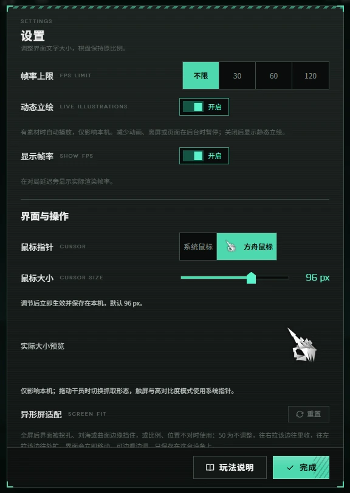

# 网页方舟鼠标与大小设置

设置 → 界面与操作 → 鼠标指针提供「系统鼠标」与「方舟鼠标」，默认方舟鼠标。
未保存鼠标主题的客户端采用新默认值；已明确保存的系统／方舟选择继续保留，服主仍可调整默认值与编辑权限。
`settings.cursorTheme` 保存在本机 `sp.pref.settings`，遵循既有客户端偏好策略；不进入战斗内容或同步给其他玩家。

方舟鼠标默认 **96 px**（第一版 32 px 的三倍）。同一区域提供「鼠标大小」滑杆和实际大小预览，
范围 32–128 px，每档 16 px；`settings.cursorSize` 立即生效并单独保存，重新打开页面仍保留。
旧偏好没有尺寸字段时使用 96 px。主机默认值和锁定策略沿用既有客户端设置机制。



截图来自当前源码的隔离实例；图中展示设置预览，原生鼠标光标不由浏览器截图自动捕获。更多本库界面与入口见 [特色图鉴](FORK-FEATURES.md)。

方舟模式使用浏览器原生 CSS 图片指针，不隐藏系统指针、不创建跟随鼠标的 DOM 图层，
也没有逐帧追踪循环。默认、可点击、文字输入、禁用、可抓取与抓取中均保留各自的操作含义。
真实干员拖拽由 GameScreen 已有的 `pieceDragStart` / `pieceDrop` / `pieceDragEnd` 状态驱动，
兼容 Pixi 棋盘和 DOM 简化棋盘。离开页面、失焦、取消或结束拖拽会清除按压与抓取状态。

触屏输入、无精细指针设备和强制高对比度模式使用系统指针；检测到鼠标后可恢复已保存的方舟选择。
减少动画模式保留静态造型，停用点击姿态切换。右键查看详情不触发按压效果。

## 素材安装

```bash
node tools/install-cursors.mjs
# 已缓存源包时完全离线重新生成
node tools/install-cursors.mjs --offline
```

完整安装的 common-art 分包携带已安装的鼠标素材；源码和精简实例可运行安装命令下载素材，游戏运行时只请求本站文件。无素材或加载失败时继续使用系统指针，设置页显示原因。
全部素材验证成功前不启用主题，避免一半控件已替换、一半仍缺图。重新选择方舟模式可重试失败的加载。

输出在被忽略的 `public/assets/cursor/arknights-e1249037/`，按 32、48、64、80、96、112、128 分目录，
含 56 张 PNG 和 `provenance.json`；根目录保留八张 32 px 兼容图供旧页面和回滚使用。
浏览器按需加载当前尺寸的八张图，尺寸切换期间保留已加载的完整指针，防止混用大小或旧加载覆盖新选择。
源包在 `.cache/cursor-source/`；安装器固定来源提交并校验两个 SHA-256，逐张记录来源帧、热点和输出哈希。
不手工修改 `data/*.json`，不把素材提交进 Git。

## 来源与适配边界

参考 [DoingStone/Arknights-Mouse](https://github.com/DoingStone/Arknights-Mouse/tree/e1249037536f46e0f39ad93e359cf29bf61aae80)，
提交 `e1249037536f46e0f39ad93e359cf29bf61aae80`：`artpack.py` 的 AKPT1 容器格式、`prtsfx.py` 的按压时序
和 PRTS Replica v8 96x 的造型。代码 MIT 许可及致谢见 [第三方声明](../THIRD-PARTY-NOTICES.md)。
美术不属于该项目原创，不在其 MIT 许可内；本库只作本地非商业试用，不声称获得美术再分发授权。

96×96 源图按预乘 alpha 作面积重采样，96 px 档保留原图字节；128 px 档由同一原图放大。
热点同比缩放，例如 96 px 为 28,20（文字指针 48,48），128 px 为 37,27（文字指针 64,64）。
抓取与抓握图采用独立热点：96 px 为 28,68，128 px 为 37,91。两种姿态共用垂直锚点，
避免切到抓握形态时图形落在实际鼠标位置下方。此为用户反馈后的 [ASSUMED] 视觉对齐；
原图、横向位置、真实点击坐标和部署落点不变。
选取 Arrow、Hand、IBeam、No 第一帧，grab_enter 第 11 帧、grab_loop 第 0 帧，
hand_normal / hand_link 第 106 帧。只输出需要的静态姿态，不下载给浏览器整包逐帧动画。

[ASSUMED] 第一版采用至少 75 ms 的单次点击挤压姿态，替代桌面版弹簧逐帧播放；
不移植 Windows 注册表、全局鼠标钩子、窗口移动检测或待机动画。它是网页适配版，未声称与当前 PC 客户端逐帧一致。

## 验证

```bash
node --test test/ui/cursor-size.test.js
SP_E2E=1 CHROME_PATH=/path/to/chrome node --test test/ui/cursor.e2e.test.js
```

浏览器测试使用人工合成指针图片，覆盖设置切换与持久化、真实干员拖拽、点击恢复、文字/禁用状态、
缺素材、触屏、减少动画与强制高对比度，以及尺寸滑杆、保存、热点、加载乱序和主机锁定。
安装器生成的真实图片另作本地视觉检查。
