# 本库特色与使用图鉴

本页介绍 **zhewang448/Stronghold-Protocol 扩展分支**的实际使用体验，按“在哪里打开、默认怎样、能做什么”展开。适合第一次选择分支的玩家，也适合想了解近期改动的服主。

**说明版本：2026-11-06，`v0.3.3-extended.12` 大更新。** 本页功能随本次扩展版提供：每阶可带 0–2 名、独立候选弹窗、动态立绘、指定 UI 迁移、外观修复、部署吸附开关与默认方舟鼠标。基础游戏仍为 0.3.3，启动器升级为 1.4.0。附件、升级路径与验证边界见 [发布说明](RELEASE-V0.3.3-EXTENDED.12.md)。

本分支沿用上游玩法、官方数据适配、确定性战斗模拟与插件基础，并整合社区方案。下文的“特色”表示本库现在提供的体验；各项的原始作者和适配来源见文末与 [README 仓库索引](../README.md#仓库索引)。

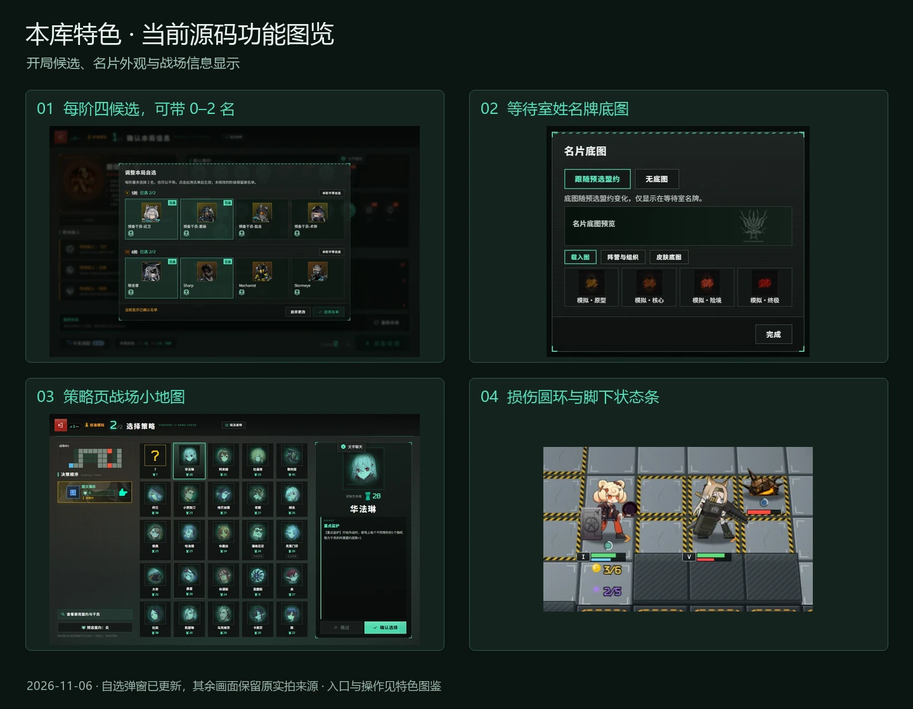

## 从哪里开始

| 你想做什么 | 入口 | 本库提供的体验 |
| --- | --- | --- |
| 先准备几套阵容 | 大厅 → 干员调配 | 命名预设、分字段应用、持有范围、皮肤与随机策略、分版本候选 |
| 开局再决定带谁 | 调配 → 自选编队；开局简报 → 本局自选 → 调整 | 5、6 阶各最多四候选，每阶可带 0、1 或 2 名；显示盟约禁用影响 |
| 换头像、立绘和姓名牌 | 个人资料；等待室本人席位 | 自定义图片、各三个本机预设、立绘取景、跟随盟约的名片底图 |
| 让界面更贴近游戏 | 设置 → 画面相关选项 | 损伤环、脚下状态条、真实过载阶段；可选商店人像突出 |
| 提前看战场与叠层 | 策略页左栏；休整期盟约盘 | 按实际地图绘制小地图，列出本人确定性预计叠层来源 |
| 和更多朋友联机 | 同盟等待室 → 同盟设置 | 默认四人，可选最多二十人；固定分组、AI、可选独立卡池和救援 |
| 找人或交流 | 大厅在线名单；等待室邀请；局内交流 | 状态、邀请、文字聊天、表情弹幕和战场标点 |
| 看上一回合发生了什么 | 局内每回合统计；本机记录；控制台 | 曲线、每回合干员排行、阵容回放与主机跨局汇总 |
| 换网址或换电脑 | 标题页 / 大厅 → 导出 / 导入个人数据 | 恢复码、文件备份与旧域名授权传输 |
| 自己开服和维护 | 启动器；本机主机控制台 | 多实例、规则默认值与权限、监控、签名更新和恢复点 |

## 每阶四候选，开局最多选二

**先在局外准备候选，再根据本局盟约决定本局带谁。** 5 阶和 6 阶各保留原来两个位置，并增加两个候补；每阶最多四名，每场可明确带 0、1 或 2 名。

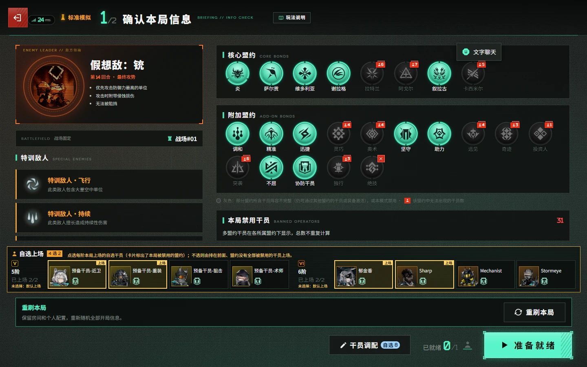

1. 在「干员调配 → 自选编队」配置本版本候选，查看“已配置候选 / 4”。原位置的先后顺序继续用于没有明确选择时的默认安排。
2. 开局简报底栏显示服务器已确认名单，例如“5阶 2名、6阶 不带”。点「调整」打开候选弹窗，本局盟约禁用状态会在卡片上标明。
3. 在弹窗中切换候选；想带零人时点对应阶的「本阶不带自选」。编辑草稿不会改变摘要、服务器阵容或库存。
4. 点「应用名单」一次提交所有修改阶；「放弃更改」、Esc 或关闭弹窗会丢弃草稿。部分修改不会在关闭或进游戏时自动应用。
5. 成功应用后更新摘要和本局个人库存，并取消本人就绪。离开简报后名单锁定；准备期超时前未提交的草稿不会生效。

没有明确修改的阶级仍优先按预设顺序选取盟约未全部禁用者，不足再取后续候选，最多两名。明确选择一名就只带这一名；空数组代表本阶不带，不会被默认值覆盖。完全禁用的候选仍可手选，但会明确警示，且沿用该干员没有商店库存的规则。

候选少于两名时按实际人数处理，不补造角色；空候选不弹选择器。重刷投票期间禁止改选，重刷后保留仍合法的明确选择（包括不带），没有明确选择的阶重新计算默认结果。

四个版本使用同一流程，保留各版本原有合法名单、重复限制、技能、模组、潜能及皮肤。旧两名配置原序保留；命名预设、个人备份和本库格式导出保留候补。支持候补但不支持 `g.diyApply` 的旧服务器使用兼容编辑：必须选满每阶名额，再按旧单阶协议提交；不显示“本阶不带”，也不会发送空选择。

**这是本库默认扩展。** 开局最多选择两名的规则沿用普通匹配与战绩归类；它与独立卡池、救援等会改变对局归类的可选房规有所区别。实现和恢复规则见 [指定 UI 迁移](STARDUST-UI-MIGRATION.md)。

## 命名预设、分版本调配与持有状态

调配顶栏可命名保存最多 **20 个预设**，支持选择、重命名、另存为和删除。手动调整不会悄悄覆盖预设；切换方案前可保存修改、直接切换或取消。

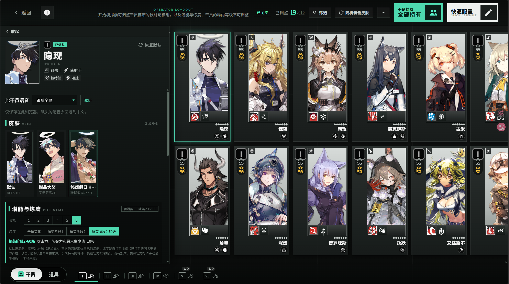

方案可以分别包含技能、模组、潜能、练度、皮肤、随机皮肤策略、锁定名单、持有状态，以及指定版本的自选编队。应用时按字段勾选，未勾选的内容保留。也可以只保存选中版本的全部干员或独有干员，名单在保存时固定，应用时不覆盖名单外配置。

导入先展示格式、范围、版本与字段预览；可缩小范围、取消不想导入的部分。含范围或候补的文件使用相应本库格式，旧格式继续可导入；上游兼容导出会说明它省略的扩展配置。预设可随个人数据迁移，**不包含棋盘站位或局内装备**。

## 动态立绘、皮肤与状态提示

**有已安装、已验证动态资源的外观自动播放。** 动态原皮、时装、完整立绘与头像 / 半身裁切按同一资源身份解析；没有动态资源、关闭动态、加载失败或有自定义图片覆盖时，显示相应静态来源。

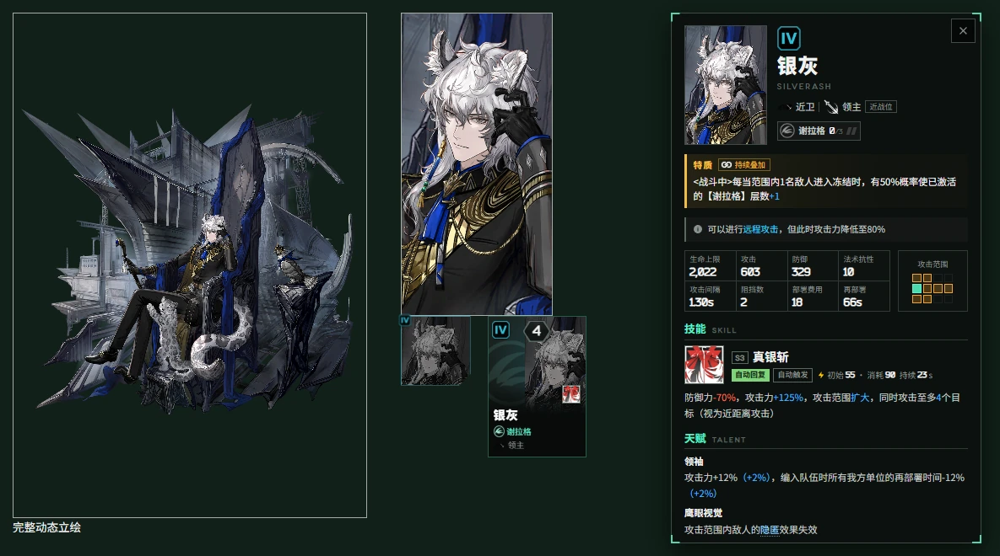

| 场景 | 当前行为 |
| --- | --- |
| 商店与晋升奖励干员卡 | 显示所选外观的可用半身 / 动态图层；静态与动态图层遵循同一裁切和文字遮罩 |
| 禁用成员或未上场缩略图 | 保留动画，同时恢复灰暗状态提示 |
| 商店资金不足 | 保留动画，同时置灰，购买资格与价格规则不变 |
| 干员详情 | 头像与所查看对象的外观一致；公共条目采用本机选择，明确的队友条目遵循队友外观与显示开关 |
| 补位、掉线与结算离开 | 动态层沿用对应静态层的灰暗提示 |
| 房间本人立绘 | 普通与动态立绘均支持取景；不同干员、阶段和时装分别保存 |

本轮额外校正了银灰「不融冰」的动态头像 / 半身裁切，避免商店小图取到衣摆。动态是否正常不能仅凭这张静态图片判断；浏览器验收另检查了就绪状态、画面随时间变化及滤镜一致性，见 [动态显示修复](UI-DYNAMIC-FIXES-20261106.md)。

皮肤可手选、随机装备或设为每局自动随机，支持锁定某名干员当前外观，默认外观也可锁定。随机范围、锁定表和皮肤可随调配导出；自动随机默认关闭，不会因刷新、重连或回档重复抽取。外观与其适用的皮肤特效不改变战斗数值。

皮肤数量与动态覆盖取决于该实例安装的目录，不承诺每名干员都有动态资源。安装、插件外观及他人皮肤开关见 [皮肤说明](SKINS.md)；动态清单与覆盖范围见 [动态支持](DYNAMIC-ILLUSTRATIONS-SUPPORT.md)。

## 等待室名片底图与个人图片

**姓名牌底图和人物立绘分别设置。** 人物仍使用原有海报、动态外观或自定义立绘；姓名牌增加独立底图层，不改变席位比例和操作区。

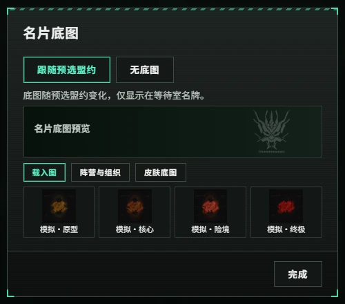

本人姓名牌的图片图标打开「名片底图」。绿色图片标识是内联 SVG 的既定图标，本身不需要下载外部图片。

| 模式 | 用途与行为 |
| --- | --- |
| **跟随预选盟约（默认）** | 八个核心盟约映射到对应阵营徽记，炎使用炎徽记；改预选会更新自动结果 |
| 无底图 | 保留人物立绘与姓名牌文字，去掉底图层 |
| 手动选择 | 从已安装的载入图、阵营 / 组织徽记、皮肤底图中选择；之后更改预选盟约不会覆盖手选 |

图片底图可以拖动、缩放和重置；徽记不提供图片裁切。取消预选、未知盟约或缺少对应素材时，自动模式不绘制底图，界面会说明原因。目录没有安装的素材不会凭空出现。

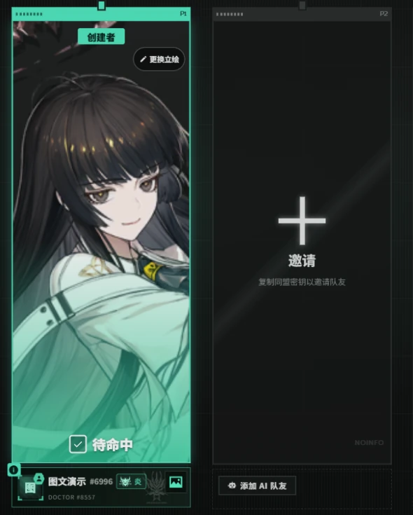

底图模式、身份和取景同步给同房间成员及观战者，并在刷新、重连和换房后恢复；AI 席位不自动继承玩家底图。此层**仅用于等待室**，策略页、结算、成就和大厅不增加底图。

个人头像与上传立绘继续保留：头像采用 1:1 取景，上传立绘采用 1:2 取景，均可拖动 / 缩放；各有 **三个本机图片预设**，保存后需显式使用，覆盖或清空需要确认。房间本人「更换立绘 → 替换立绘」集中提供预览、取景、缩放、重置及图片管理；普通 / 动态立绘可在房间直接拖动或滚轮调整。预设与原图取景保存在本机，当前启用的上传图片通过原有房间流程共享。

## 还原战场状态条

设置中的 **「还原战场状态条」默认开启**，一个总开关控制损伤圆环、脚下生命 / 技力条和过载分段；关闭立即回到本库此前的显示。

| 原显示 | 开启还原显示 |
| --- | --- |
| 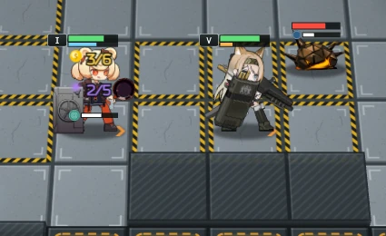 | 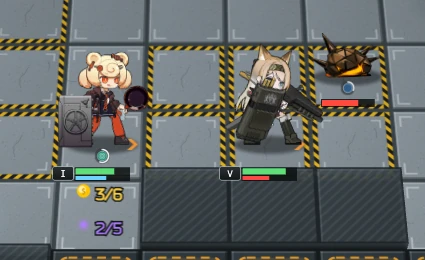 |

显示按干员、召唤物、敌人、领袖和装置等类型安排，保留头顶状态图标，处理弹药、能量、金币、狼影、倒地计时、负生命值与飞行单位的附加读数。素材可用时使用官方 `ui/ep` 图像，未安装、加载失败或未就绪时使用相同位置的程序圆环。

过载读取实际技能阶段，目前覆盖塔露拉 S3、维什戴尔 S2、号角 S3 与本地已有的洛洛 S2。第一阶段结束后进入红色第二阶段，号角 S2 继续使用弹药显示；不会仅因名称含“过载”就套用。开关不重开战斗，不改变技能时长、伤害或控制。

## 商店人像突出与真实库存

设置中的 **「突出商店人像」默认关闭**。开启后放大并适度提亮干员人像，调整文字渐变带；商店与复用卡片的晋升奖励一同生效。

| 默认关闭 | 开启后 |
| --- | --- |
| 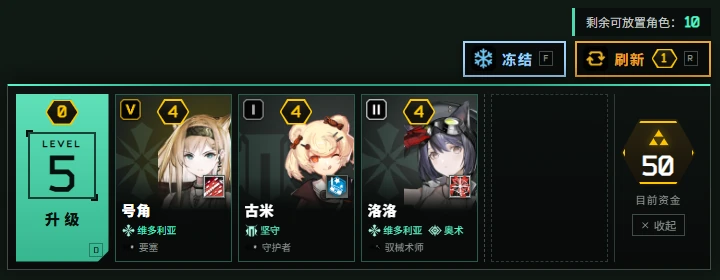 | 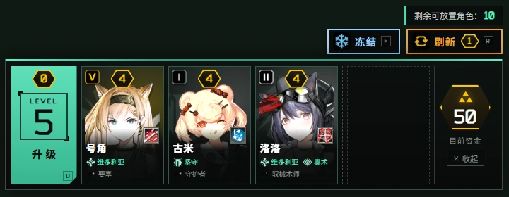 |

两种样式保持卡片尺寸、字体、商品排序、库存、价格、购买确认和技能图标位置逻辑；装备卡保持原样。动态与静态外观使用同一裁切边界，资金不足时两者都有灰暗提示，动画仍可继续播放。

本库还会在商店卡片显示真实干员 / 装备余量，在盟约展开页列出成员库存。共享池交易、个人自选库存及可选独立卡池分别按真实库存刷新，不能把展示数字当作额外库存。详细默认值与适配来源见 [UI 迁移说明](STARDUST-UI-MIGRATION.md)。

## 策略页战场小地图

**选策略前即可查看本局真实地形。** 小地图在左侧决策顺序栏顶部，按当前权威地图的数据绘制道路、高台、入口和保护点，并标注地图名称。

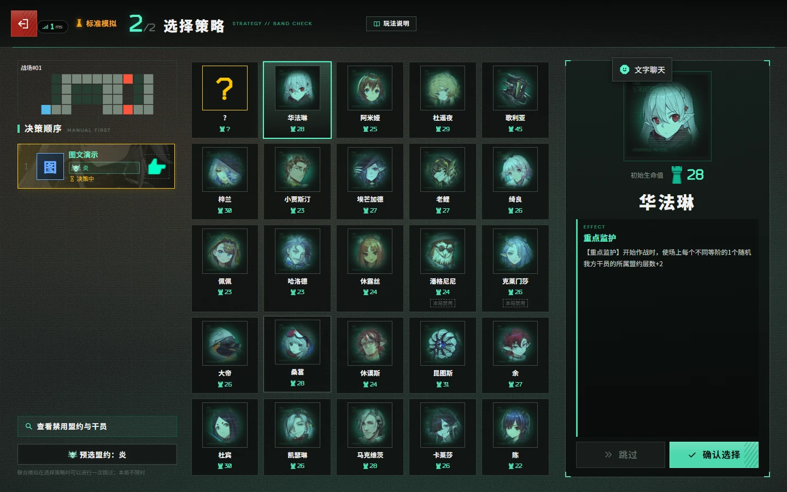

地图按左栏宽度等比缩放；短屏收紧地图高度，名单独立滚动并保持当前决策者可见。原三栏宽度、策略卡、详情区与顶部倒计时比例保留。地图缺失时显示不可用状态，切版、重刷和重连后按新的地图刷新。

它直接读取地图数据，不需要额外地图图片，也不推测敌人的移动路线。本次没有连带迁移同时选策略、方向摇杆或倍速投票。

## 休整期预计叠层与来源

休整期盟约盘可显示本人**休整期结束时确定会增加的层数**，打开详情可查看来源与数量，便于部署前比较不同阵容。

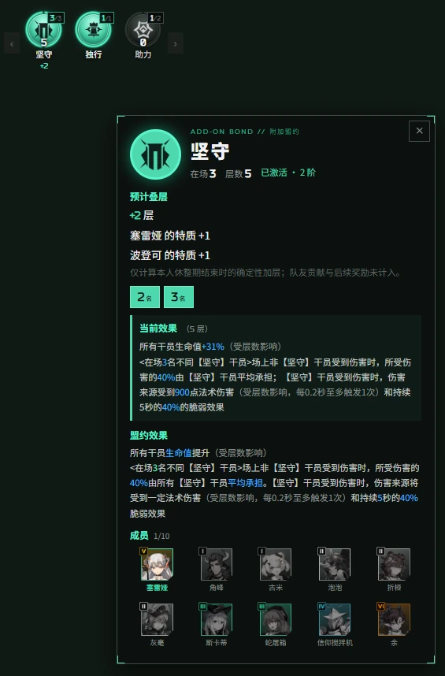

预测遵循真实结算顺序、激活条件与层数上限；后面的确定性效果会读取前面预计加层后的层数。部署、购买、出售、装备或相关状态变化后更新，输入未变时复用结果。

| 计入确定值 | 不计入确定值 |
| --- | --- |
| 本人当前准备状态下可确定的休整期结束加层 | 随机来源、队友后续贡献、玩法插件处理器及后续奖励级联 |

界面会说明随机和部分来源的限制。预测只提供给本人存活席位的准备期私有视图，不写入公共广播、回放或恢复快照；它不改变棋盘、资金、库存、真实随机数或派发队列。异常时隐藏增量并记录诊断，不阻止准备和开战。**预计值不等于全队最终结算保证值。**

## 默认方舟鼠标与大小预览

「设置 → 界面与操作 → 鼠标指针」默认选择 **方舟鼠标、96 px**。大小可在 **32–128 px** 间每档 16 px 调整，同一区域显示实际大小预览；主题与大小立即生效并保存在本机。

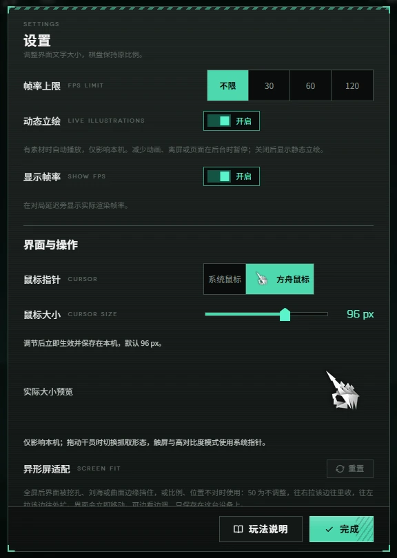

默认、可点击、文字输入、禁用、可抓取和抓取中有各自姿态，干员抓取使用真实拖拽状态与独立热点。它使用浏览器原生图片指针，不增加跟随鼠标的页面图层。

首次或未保存主题时使用新默认值；已经明确选择系统 / 方舟的玩家继续使用原选择。服主可以统一默认值与编辑权限。纯触屏、高对比度、缺素材或加载失败时回退为系统指针；减少动画时保留静态造型、停用按压切换。

截图展示设置中的实际图片预览，**浏览器截图不会自动拍到原生鼠标光标**。源码实例需按 [鼠标安装说明](CURSOR.md) 准备可选本地素材；主题默认开启不代表所有安装包都已经包含素材。

## 多人扩容、AI 与可选房规

同盟等待室可选择 **4 / 8 / 10 / 16 / 20 人**，默认四人，空位可加 AI。六人起使用固定卡池分组，二十人时为 A–E 五组、每组四人；组间库存独立，策略与机变按组并行、组内顺序选择，退出后不重组。联防每场仍最多两名助手，不扩大棋盘。

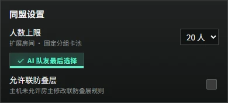

除人数以外，房间还可设置私密状态、自定义四位字母 / 数字密钥、AI 开局策略、敌人血量倍率，以及服主允许的便利规则。更改需要重新准备的房规会清除其他真人的就绪，开局后按既有锁定规则执行。

| 选项 | 默认与用途 | 匹配 / 记录边界 |
| --- | --- | --- |
| 独立卡池 | 关闭；每位玩家与 AI 各有完整干员 / 装备库存，个人自选仍独立 | 非官方房规，不参加公开匹配，默认不计入官方统计与成就 |
| 队友救援 | 关闭；符合条件的在线真人在联防后窗口内支付 10 生命救回队友 | 非官方房规；至少保留 1 生命、每目标每局一次，AI 不自动救援 |
| 敌人血量倍率 | 1 倍；可选 0.1–100 倍，作用于普通敌人与领袖血池 | 非 1 倍时显示倍率，并按非官方房间处理 |
| AI 开局策略 | 自动选择；房主可给单个 AI 指定偏好 | 已被队友选择时回退，不扩展该版本策略合法范围 |
| 观战席 | 默认两名；服主可配置 2–20 名 | 观战者不计入参战人数与分组 |

人数扩容的分组统计、回档和重启恢复适配见 [扩展联机](EXPANDED-COOP.md)。具体房规优先以当前服主权限和插件约束为准。

## 在线邀请、聊天、表情与战场标点

大厅在线名单可查看**本服**可见玩家，按姓名搜索，并识别大厅、房间或对局状态。本人可选择在线、暂离、忙碌或隐身；等待室可邀请，对方确认后加入。隐身不出现在在线名单和可见人数中，也不能收发邀请，共同房间内的实际席位仍可见。

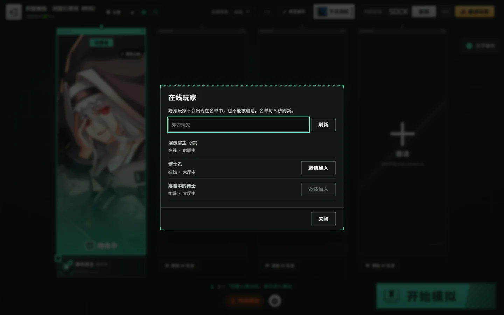

文字聊天、表情弹幕和战场标点覆盖局内常见沟通场景。表情支持本机单选 / 随机发送，服主可实时开关和限速；四人名单的气泡按实际头像对齐，包含第四席及滚动场景。聊天和标点可拖动，小屏工具区可横向滚动。

服主可配置在线名单、邀请、状态、隐身及可见人数权限，使用屏蔽词、禁言、踢出、公告和清空管理交流。公告支持模板、Markdown 预览与草稿跨重启保存；普通玩家聊天不因此变成永久聊天记录。

## 统计、逐回合记录与回放

局内「每回合统计」可在**回合曲线**与**每回合干员伤害排行**之间切换，玩家和观战者均可查看，服主默认开放。曲线提供指标与数值表格，排行可筛选回合、玩家及前十 / 全部；多人扩容另有本组 / 全部玩家范围。

本机记录保存个人对局；主机可查看跨局汇总、漏怪来源、经济与盟约层数变化、逐回合阵容及最近 50 局回放。当前排行按棋子实例累计，同名棋子不会合并；旧记录缺少实例编号时无法拆回历史数据。

显示功能不修改战斗结果。非官方房规的统计范围与过滤沿用本库规则，旧记录缺失的字段显示缺失，不凭空补成新的实测结果。

## 个人数据备份与跨域名迁移

标题页或大厅的「导出 / 导入个人数据」可生成恢复码，复制或保存为 `.spdata` 文件。适合换浏览器、换电脑、清理站点数据，或临时公网网址变更前备份。

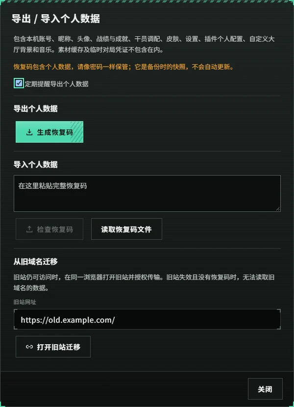

备份覆盖本机资料、昵称头像、战绩成就、干员调配 / 持有 / 候选编队、命名预设、皮肤与随机策略、界面偏好、插件个人配置，以及自定义背景和音乐。名片模式和取景等本机偏好也随恢复码迁移。头像 / 立绘的三个图片预设位存于独立本机图片库，**当前恢复码不打包该图片库**，换浏览器需另外保留原图。

恢复码不提供线上账号系统，不携带主机管理权限或浏览器缓存；旧域名传输需要在对应来源授权。备份内容与大小限制、恢复方式见 [域名迁移](DOMAIN-RECOVERY.md) 和 [隐私说明](PRIVACY.md)。

## 服主默认值、控制台与自行开服

**把房间默认值和玩家个人偏好分别管好。** 主机控制台可搜索设置，分别提供新房默认值及房主修改权限；客户端偏好也有服主默认值和“允许用户更改”。允许时个人显式值优先，锁定只改变实际生效值，不抹掉原始偏好，解锁后恢复。

控制台支持房间 / 玩家管理、棋盘与数值编辑、干员和道具发放、实时查看与代操作、回档、敌人日程、每页四席监控墙、资源监控及统计。它只向开服电脑本机提供管理入口，普通玩家不会因此获得管理能力。

Windows 启动器可创建或导入实例、准备便携 Node.js、启动服务和管理更新。公网临时地址可通过 cloudflared 提供；关闭启动器窗口后服务继续运行，停服需要显式停止。控制台签名更新可比较增量链与素材分包，并保留已验证恢复点。

需要分清三类恢复：**个人数据备份**恢复浏览器配置；**对局恢复**在同版本 / 同规则指纹下回到最近休整期开始；**程序恢复点**恢复一次更新前的程序。跨版本升级不保证续局，作战中重启通常需重打本回合。使用与限制见 [启动器](../launcher/README.md)、[部署](DEPLOY.md) 和 [开服脚本](../scripts/README.md)。

部署相关设置还包括“部署时按格子吸附”，默认开启。关闭后只改变拖动预览，干员模型可自由跟随鼠标或触点；松开依然落在指针下的合法格子。可与“部署时镜头缩放”分别设置，服主也可指定默认值和修改权限。

## 手机横屏与素材加载

等待室、调配、简报、策略页、局内 HUD 和统计按小屏横屏适配。新增小地图使用左栏内部空间；候选缩入简报底栏摘要，弹窗内部滚动且保留底部“应用名单”操作；名片选择器可关闭与滚动。

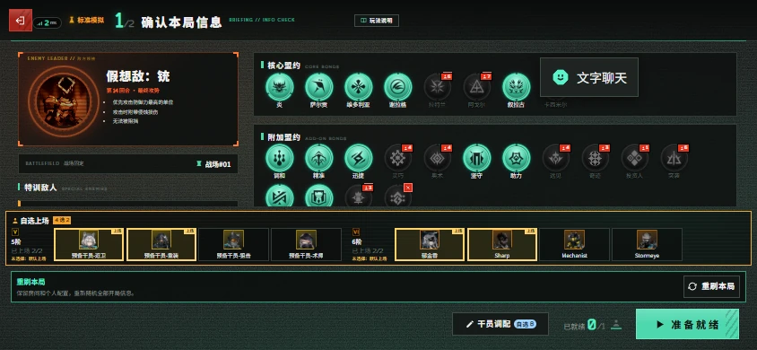

近期 UI 验收覆盖 1440×900、1280×720、844×390、640×360，以及四档字号和 75% / 100% 界面大小的相关组合。这里展示的是浏览器视口，不能替代所有实体设备、系统与 Safari 的验证。

素材入口可按必需画面、可选音频和语音语言预载，支持暂停 / 继续、失败重试、清缓存和 ZIP 导入 / 导出。预载只处理实例已安装的资源，不等于安装缺失皮肤；缓存也不接管 API 或 WebSocket。动态立绘、官方状态条和方舟鼠标各自保留静态 / 程序 / 系统回退。

## 常用默认值速查

下表为代码默认值，实际房间仍可能受到服主策略、既有个人配置或插件约束。

| 项目 | 当前默认 | 改动位置 / 说明 |
| --- | --- | --- |
| 官方玩法版本 | 四个均开放，默认第二期下半 | 大厅 / 房间版本选择；服主可缩小开放范围 |
| 开局候选 | 每阶最多四名、可带 0–2 名 | 简报摘要 → 调整；需应用名单，旧两名配置沿用 |
| 还原战场状态条 | 开 | 设置；总开关即时生效 |
| 部署时按格子吸附 | 开 | 设置 → 战斗显示；关闭后模型自由跟随指针，实际仍按格子放置 |
| 突出商店人像 | 关 | 设置；干员商店与晋升卡共用 |
| 策略战场小地图 | 显示 | 跟随当前地图，无需另装地图图片 |
| 名片底图 | 跟随预选盟约 | 等待室本人姓名牌的图片入口 |
| 预计叠层 | 准备期可用时显示 | 本人盟约盘；只计确定性来源 |
| 动态立绘 | 自动 | 有资源且允许播放时启用，亦可选静态 |
| 显示其他玩家皮肤 | 开 | 设置；本人外观与公共详情按现有归属规则 |
| 每局自动随机皮肤 | 关 | 干员调配 → 随机设置 |
| 鼠标主题 / 大小 | 方舟 / 96 px | 设置 → 界面与操作；保留个人显式选择 |
| 同盟人数上限 | 四人 | 同盟设置可选至二十人 |
| 独立卡池 / 队友救援 | 关 / 关 | 可选非官方房规 |
| 敌人血量倍率 | 1 倍 | 同盟设置，受服主权限约束 |
| 观战席 | 两名 | 服主可配置 2–20 |
| 每回合统计 | 开 | 主机可统一控制显示 |

## 来源、图片与进一步阅读

| 内容 | 来源与本库适配 |
| --- | --- |
| 游戏、确定性模拟、官方数据、插件基础 | [sganggs/Stronghold-Protocol](https://github.com/sganggs/Stronghold-Protocol)；继承上游基础 |
| 多人扩容与分组 | LongQianChen 原方案、SiderLock 适配；本库整合统计、回档与恢复 |
| 社区大厅、等待室、HUD 和手机布局 | isomerpoi 原始 UI、xinhai-ai 后续参考；按本库流程适配 |
| 独立卡池、救援、动态立绘及本次指定 UI | [Stardust-minus/Stronghold-Protocol](https://github.com/Stardust-minus/Stronghold-Protocol)；指定 UI 固定参考 `7f39464`，GPL-3.0-or-later，保留本库个人配置与多人逻辑 |
| 库存、自定义头像 / 立绘及反馈 | DoraCat（@DuolaCCCCat）的建议、PR 与验收反馈；由本库适配已有同步链路 |
| 网页方舟鼠标 | DoingStone/Arknights-Mouse `e1249037`；容器与姿态代码参考 MIT 项目，美术不属于 MIT 授权 |
| 个人备份、主机管理、统计维护与兼容修复 | 本库新增及持续适配；各项实现与历史见扩展记录 |

感谢所有原作者与社区贡献者。完整仓库链接、贡献范围与许可见 [仓库索引](../README.md#仓库索引)、[NOTICE](../NOTICE.md) 和 [第三方声明](../THIRD-PARTY-NOTICES.md)。游戏截图含有的官方素材权利仍归原权利人，不因文档代码使用 GPL 就改变其权利归属。

新图来自对应源码的隔离测试实例：真实等待室、简报、策略和设置界面通过正常界面流程拍摄；HUD、商店、叠层与动态对照使用实际组件 / 渲染器和可重复的演示输入。局部图有裁切，封面只拼接实际截图并加标题，没有生成游戏界面。旧图在正文注明版本，详情与图片哈希见 [截图说明](img/features/README.md)。

本轮没有迁移 Stardust 的同盟设置分页、同时选策略、方向摇杆、倍速投票或额外大厅布局。分页降低长列表负担、区分同盟 / 规则 / 卡池并标记已修改页签的优点记录为后续方向，未来仍须保留本库房间默认值、权限与恢复默认能力。

继续阅读：[完整使用说明](PLAYING.md) · [扩展更新记录](LOCAL-CHANGELOG.md) · [指定 UI 迁移](STARDUST-UI-MIGRATION.md) · [动态显示修复](UI-DYNAMIC-FIXES-20261106.md) · [鼠标设置](CURSOR.md) · [开发笔记](LOCAL-DEV.md)。

## 动态素材按需下载

动态播放和素材下载分别设置。首次安装/浏览器批量预载默认不下载动态动画，静态头像、商店竖图和同皮肤立绘正常保留；已有动画在取消下载后仍可继续使用。

- **浏览器**：标题页或设置打开「素材与资源」，勾选「下载动态立绘」后开始预载。此项独立于语音、音效的「同时预载」，支持服主默认值、用户权限、个人保存和个人数据备份；兼容 HTTP 下载同样生效。取消勾选不会清缓存，混合资源 ZIP 含未选择动画时改用所选单文件。
- **控制台**：版本更新中的「下载动态立绘」决定本次更新范围，与玩家播放方式分开保存。没有动画的新实例默认关闭，原已安装动画的实例首次默认开启。后续可选当前版本，勾选并「修复素材并重启」补装；准备中的更新更改范围会重新核验。
- **启动器 1.4.0**：新建实例在安装路径下勾选「下载动态立绘（可选）」。默认基础包包含静态图片，动画包单独验签和校验，已有实例从控制台补装。
- **手动下载**：lite ＋ common/local/fx 是基础安装，dynamic-art 为额外可选包。旧更新器首次升级仍可能下载完整动态增量，升到本版后才具备选择能力。

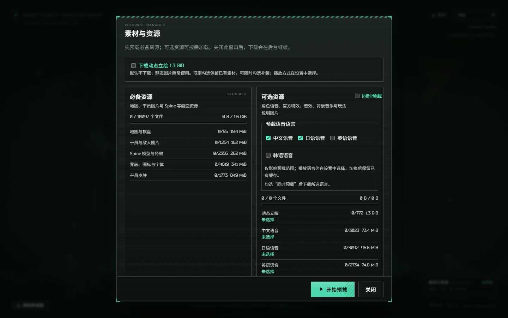

这项扩展只改变下载范围；省略的动画在服务端清单视图中回退为静态，源数据不被改写。所有基础素材仍完整校验，动态包不能把程序、静态图片或其他素材标为可选。安装路径与发布签名规则沿用原有机制。
