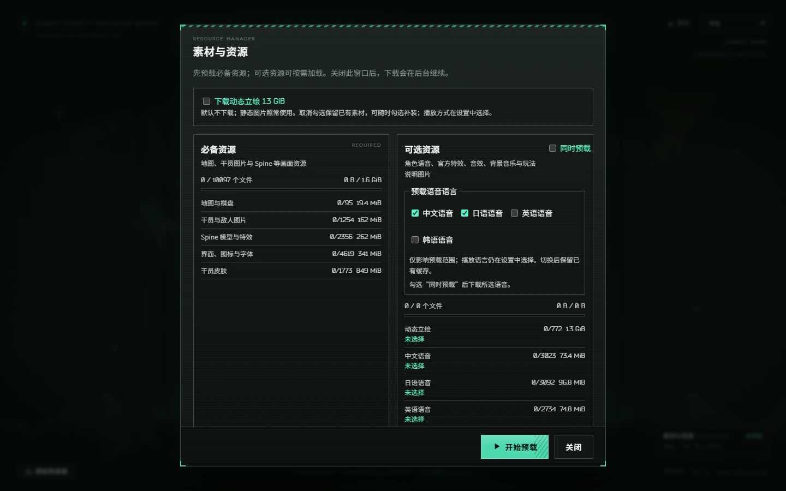

# v0.3.3-extended.12 · 大更新：动态外观、自选与战场界面

日期：2026-11-06（Asia/Shanghai）。基础游戏 0.3.3，Windows 启动器 1.4.0。

这是一次覆盖局外调配、开局选择、等待室、战场显示与服主管理的**大更新**。当前代码保留四个玩法版本、多人扩容、局内交流、统计、个人数据及恢复机制。完整图文与入口见 [本库特色图鉴](FORK-FEATURES.md)。

## 动态外观与新增自选

- 接入已核验动态原皮/时装的完整立绘、头像与半身裁切，支持自动/静态切换、预览取景和静态回退；仅已安装且通过验证的资源会播放。
- 第二期下半自选新增塔露拉、国度、冻河，沿用技能、潜能、模组、库存和该版本合法名单；其他历史版本不扩展这三人的名单。
- 动态播放时保留禁用、资金不足、补位、掉线和离开状态的置灰；详情头像跟随对应皮肤，修正银灰“不融冰”小图裁切。

## 开局自选：每阶最多四候选，可带 0–2 名

5、6 阶各配最多四名，未改动时默认优先使用盟约未全部禁用者。简报底栏只显示已确认名单，点击“调整”打开独立弹窗：可取消到零人，点“应用名单”整体确认，也可放弃草稿。明确不带不会补回默认名单，重刷、重连、回档和恢复沿用确认结果。此为本库默认扩展，继续普通匹配及战绩归类。

## 战场、商店与等待室

| 项目 | 默认与变化 |
| --- | --- |
| 还原战场状态条 | 开；脚下生命/技力条、损伤圆环、实际过载阶段；缺可选素材使用程序回退 |
| 突出商店人像 | 关；开启放大提亮人像，卡片尺寸、装备卡和购买规则保留 |
| 战场小地图 | 策略左栏显示实际地图地形，不推测路线 |
| 预计叠层 | 休整期显示本人确定性增量与来源，随机、队友后续贡献和插件不计入确定值 |
| 名片底图 | 等待室默认跟随预选盟约；支持无底图或手动目录选择、图片取景与同步 |
| 方舟鼠标 | 默认 96 px，可调 32–128 px；完整包附素材，精简包可安装，缺素材回退系统指针 |
| 部署时按格子吸附 | 开；关闭后模型自由跟随指针，实际仍放入指针下的合法格子 |

等待室保留人物海报、动态立绘、上传头像/立绘、取景与各三个本机图片预设。四人列表的第四席表情位置修复，小屏选择弹窗独立滚动，不再占据大块本局信息空间。头像/立绘图片库预设当前不随恢复码打包，换浏览器前请保留原图。

## 客户端偏好与控制台

服主可设置客户端首次默认值及“允许用户更改”，锁定只改变生效值，不抹掉个人显式选择，解锁后恢复。新增 UI 开关、鼠标和吸附选项均接入该目录。控制台增加可选登录和远程访问设置；原本机访问流程继续保留，远程访问按实际配置与权限校验运行。

## 下载与升级

本次将素材拆为基础三组和独立可选动画包，每个发布附件均低于 GitHub 的 2 GiB 限制，不上传超限的单体完整 ZIP。

| 入口 | 下载动态立绘 | 已有素材与补装 |
| --- | --- | --- |
| 浏览器「素材与资源」 | 独立勾选，默认关闭，显示本服务器所提供动画的大小；不依赖「同时预载」 | 取消不清缓存；之后勾选继续。HTTPS 预载与 HTTP 兼容下载均遵守选择 |
| 控制台「版本更新」 | 勾选是否下载/更新动态包，选择持久保存；首次无动画时关闭，原已装动画的实例默认开启 | 不勾选保留已有动画；选当前版本、勾选并「修复素材并重启」可补装 |
| Windows 启动器 1.4.0 | 新建实例提供默认未勾选项 | 已有实例使用控制台补装；关闭启动器不停止服务器 |

手动基础安装下载 **lite、common-art、local-art、fx-art** 四个 ZIP，将内部 `Stronghold-Protocol` 文件夹合并到新目录；需要动画再合并 **dynamic-art.zip**。头像、半身图与静态立绘即使位于 dynamic 目录，也仍随基础包提供。不装动画时服务端不发布缺失的动画记录，显示同皮肤静态图；不影响播放设置、玩法或库存。网络、哈希或分包校验失败时，未选择动画的任务不会偷偷改下含全动画的大包。

旧 v9/v10 更新器可使用包含全部变化素材的签名增量包完成首次升级，之后才有下载选择；希望首次升级也跳过动画的用户请用 1.4.0 新建实例或手动合并基础包。新更新器在关闭动画时只走分包路径。历史 Release 没有独立动态包的，需选择含动态完整安装。另发布增量索引、启动器与 SHA-256/Ed25519 签名。

增量直接支持已发布 v0.3.3-extended.9 与 v0.3.3-extended.10；更早版本先升级到受支持版或使用完整包。**升级前结束对局，导出个人数据并保留 logs。跨代码版本的对局快照不保证续局，不要在活动对局中手工覆盖文件。** 本次发布不主动重启维护者正在运行的实例。

## 验证与来源

本次候选完整 `npm run ci` 通过：**11,490 项，11,160 pass、330 skipped、0 fail**，setup、smoke、guards、lint、imports、typecheck 全部通过。`npm run golden` 的 **303 场景全部一致**，未改期望。

专项检查覆盖动态下载选择、基础静态图、签名分组、跳过/保留/补装、暂存范围切换、客户端偏好和包装导入边界；114 项集中 Node 检查通过，后续暂停切换回归 15 项通过。真实 Chromium/Edge 的素材页、控制台、鼠标、吸附及自选弹窗通过；素材页验证四种尺寸无横向溢出、选择持久保存。启动器 WPF 构建通过，原生分包安装 10 项、完整安装与多实例 23 项通过。四语言 3,306/3,306，无缺词。发布附件继续按逐文件哈希、CRC、旧版安装与回滚流程核验，详细记录保存在本机发布证据目录。

感谢 sganggs 及上游贡献者，Stardust-minus 及其仓库贡献者（指定 UI 参考 7f39464，GPL-3.0-or-later），DoingStone/Arknights-Mouse（固定 e1249037，代码 MIT，美术不属于 MIT 授权），以及 DoraCat、isomerpoi、xinhai-ai 与其他社区作者。完整贡献范围与许可见 [仓库索引](../README.md#仓库索引)、[NOTICE](../NOTICE.md) 与 [第三方声明](../THIRD-PARTY-NOTICES.md)。

**如果这次大更新让你玩得更顺手，欢迎点一下仓库右上角的 Star ⭐。** 也欢迎继续反馈问题和复现步骤，帮助这个非商业同人项目改进。
